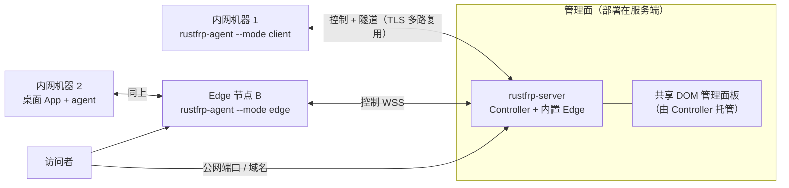

# RustFRP 需求说明书（PRD）V1.0

> **2026-10-14 架构决策修订**：G6 的 Flutter 单工程已由 `docs/UI_REFACTOR_PLAN_20261014.md` 替换为 `rustfrp-ui/` 原生 HTML/CSS/TypeScript + Tauri 系统 WebView；Web 与桌面共用同一 UI 构建。本文中 Flutter/Dart 工程、平台导入和构建描述为历史方案，不再是当前实现要求；当前实施/验收见 `docs/UI_REFACTOR_STATUS.md`。

> 状态：草案，待评审　｜　编制日期：2026-10-11
> 配套文档：[技术设计文档](RUSTFRP_TECH_DESIGN_V1.0.md)（架构、UI、Model、目录）
> 参考项目：`/data/www/linkory/`（Monorepo 结构与 UI 规范）；功能参考：[fatedier/frp](https://github.com/fatedier/frp)
> 项目名称：**RustFRP**（已确定）；主域名 `rustfrp.com`（含 `www.`）；代码前缀 `rustfrp-`。
> 两条最高优先级的整体设计原则见 [技术设计文档 §0](RUSTFRP_TECH_DESIGN_V1.0.md)：**极致省内存（典型场景 ≈10 MB）**、**配置层完全兼容 frp**。

---

## 1. 背景与目标

### 1.1 背景

frp 是最常用的内网穿透工具，但存在几个痛点：

1. **配置靠手写 TOML**，多台客户端、多台服务端时无法集中管理，改一条隧道要 SSH 到每台机器。
2. **没有真正的管理面**：自带 dashboard 只读，不能下发配置、不能接入新机器。
3. **Go 运行时内存偏高**：frps 空载常驻几十 MB，在 256MB 以下的小 VPS、路由器、NAS 上有压力。
4. **没有桌面客户端**：普通用户要自己写配置、自己配开机启动。

### 1.2 产品目标

做一个**用 Rust 实现、内存占用极低、带可视化管理的 FRP 类内网穿透系统**：

| # | 目标 | 衡量方式 |
|---|---|---|
| G1 | **功能对标 frp 主干**：TCP / UDP / HTTP / HTTPS / STCP / SUDP / XTCP，域名与子域名路由，鉴权，加密压缩，带宽限制，健康检查，负载均衡 | 功能对照表（§5）逐项验收 |
| G2 | **极致省内存**：Server、Agent 典型运行都在 **≈10 MB** 量级 | 见 §6.1 的内存预算，用基准测试脚本持续回归 |
| G8 | **配置层完全兼容 frp**：frps/frpc 的配置文件（TOML/YAML/JSON，及旧版 INI 经转换）无需修改即可使用，并支持导入与导出 | 兼容性测试集（§5.4）全部通过，无静默忽略 |
| G3 | **集中管理**：一个管理面板管理所有服务端节点和客户端，配置在面板里改、自动下发、热生效 | 不登录任何机器即可新增/修改/停用隧道 |
| G4 | **一行命令接入新机器**：面板生成安装命令，粘贴到目标机器执行即可接入 | 接入耗时 < 1 分钟 |
| G5 | **三个桌面系统都有原生客户端**：macOS / Linux / Windows | 三平台安装包 + 实机验证 |
| G6（2026-10-14 修订） | **一套原生 HTML/CSS/TypeScript UI 用于 Web 管理面板和桌面客户端**，桌面由 Tauri 系统 WebView 承载 | `rustfrp-ui/` 同一构建由 Controller 托管并嵌入 Tauri 包 |
| G7 | **官方网站**：产品介绍、下载、文档入口 | 站点上线，下载链接指向 Release |

### 1.3 非目标（V1.0 不做）

- **不要求线上协议与官方 frp 互通**。协议可自研（见技术文档 §4.1），官方 frpc 不能直连 RustFRP 服务端，反之亦然；**但配置层必须完全兼容**（G8），迁移时两端一起换成 RustFRP 即可。可选的「frp 线协议兼容模式」放 V1.1 评估（便于灰度迁移）。
- **不做 Android / iOS 客户端**，V2.0 再评估。
- **不做多租户 SaaS 计费**。V1.0 面向「个人 / 小团队自建」。
- Web 与桌面只维护一套共享 DOM 管理 UI，不维护第二套业务前端。
- KCP / QUIC 传输：配置项会被**识别并给出明确提示**，V1.0 不实现（回落 TCP），QUIC 在 V1.1 评估。

---

## 2. 用户与场景

| 角色 | 描述 | 典型诉求 |
|---|---|---|
| **站长 / 运维**（主要用户） | 有 1~N 台公网 VPS 和若干内网机器 | 在面板里加机器、加隧道、看流量和日志；VPS 配置低，要求吃内存少 |
| **团队成员** | 受邀使用部分隧道 | 只读或只管理自己的隧道，不碰服务器 |
| **普通桌面用户** | 想把家里的 NAS / 开发机暴露出去 | 装个桌面 App，点几下，不写配置 |
| **访问者** | 通过公网地址访问被穿透的服务 | 无感，延迟低 |

核心场景：

- **S1 暴露内网 Web 服务**：家里 NAS 的 5000 端口，经 `nas.example.com` 以 HTTPS 访问。
- **S2 SSH 远程登录**：公司内网机器的 22 端口映射到公网 VPS 的 6000 端口。
- **S3 私密访问（STCP）**：不开公网端口，访问者本机也运行 agent，通过共享密钥访问内网服务。
- **S4 多节点**：国内、海外各一台边缘节点，同一个隧道可选择走哪个节点。
- **S5 批量接入**：公司 20 台机器，在面板里生成 20 个一次性接入命令。

---

## 3. 系统构成



| 组件 | 说明 |
|---|---|
| **Controller（`rustfrp-server`）** | 管理面：账号、节点、客户端、隧道、审计、配置下发；**默认内置一个 Edge**，单机部署一个二进制就够用 |
| **Edge（服务端 Agent）** | 数据面：监听公网端口、接受客户端隧道连接、转发流量，相当于 frps。可独立部署到更多 VPS，由 Controller 统一管理 |
| **Client Agent（客户端 Agent）** | 运行在内网机器上，相当于 frpc。无界面，可作为系统服务常驻 |
| **桌面客户端** | Tauri + 系统 WebView（macOS / Linux / Windows），管理本机 Client Agent，也可连接 Controller 作为管理控制台 |
| **管理面板（Web）** | `rustfrp-ui/` 原生 HTML/CSS/TypeScript，由 Controller 托管并与桌面共用 |
| **官方网站** | 静态站点，介绍、下载、文档 |

> `rustfrp-agent` 是**同一个二进制**，通过 `--mode client|edge` 区分角色，减少发布物和维护量。

---

## 4. 功能需求

优先级：**P0** = V1.0 必须；**P1** = V1.0 目标，可延期到 V1.1；**P2** = 后续。

### 4.1 管理面板（Web，由 Controller 托管）

| ID | 功能 | 优先级 | 说明 |
|---|---|---|---|
| M-01 | 管理员登录 / 登出 | P0 | Cookie 会话；无默认账号，首个管理员通过服务器 CLI 创建（沿用 linkory `admin create`） |
| M-02 | 概览 | P0 | 节点/客户端在线数、隧道数、当前连接数、今日流量、Controller 自身内存/CPU/运行时长 |
| M-03 | 节点（Edge）管理 | P0 | 列表、状态、版本、公网地址、可用端口范围、接入新节点、停用、删除 |
| M-04 | 客户端管理 | P0 | 列表、在线状态、系统/版本/IP、重命名、标签、停用、强制下线、删除、远程重启 |
| M-05 | **接入新客户端 / 新节点** | P0 | 向导：选平台 → 生成一次性接入令牌 → 展示安装命令与下载链接 → 等待设备上线（实时反馈） |
| M-06 | 隧道管理 | P0 | 增删改查、启停；按客户端/节点/类型/状态筛选；改动后秒级下发并热生效 |
| M-07 | 隧道模板与批量 | P1 | 常用模板（SSH / RDP / Web / 数据库）；批量启停 |
| M-08 | 域名管理 | P1 | 自定义域名、子域名后缀、TLS 证书上传 / ACME 自动签发（P2） |
| M-09 | 实时流量与连接 | P0 | 每隧道当前连接数、上下行速率、累计流量；近 24h / 7d 曲线 |
| M-10 | 日志 | P1 | 节点/客户端最近日志的实时尾随（环形缓冲，不落盘） |
| M-11 | 审计 | P0 | 所有写操作记录操作者、对象、理由、时间；不记录密钥与流量内容 |
| M-12 | 管理员与角色 | P0 | Owner / Admin / Operator / Viewer 四角色；页面与服务端双重鉴权 |
| M-13 | 访问令牌 | P1 | 为自动化创建 API Token（可限定范围、可撤销） |
| M-14 | 深浅色主题、窄屏适配 | P0 | 与 linkory 一致，390px 宽可用 |
| M-15 | 告警 | P2 | 节点/客户端离线、端口冲突、证书到期 Webhook 通知 |

### 4.2 桌面客户端（macOS / Linux / Windows）

| ID | 功能 | 优先级 | 说明 |
|---|---|---|---|
| D-01 | 三平台安装包 | P0 | macOS `.dmg`（签名公证）；Windows `setup.exe` + zip；Linux `.deb` + `tar.gz` |
| D-02 | 内置并托管本机 Client Agent | P0 | App 首次启动安装/启动 agent 系统服务；关闭 App 隧道不中断 |
| D-03 | 连接到 Controller | P0 | 输入 Controller 地址 + 接入令牌，一步接入；或扫码/粘贴「接入链接」 |
| D-04 | 本机隧道列表与状态 | P0 | 看本机有哪些隧道、是否在线、公网地址（一键复制）、流量 |
| D-05 | 本机快速新增隧道 | P0 | 选类型 → 填本地地址 → 选节点 → 完成（由 Controller 落库并下发） |
| D-06 | **管理员控制台模式** | P0 | 用管理员账号登录 Controller，使用与 Web 相同的全部管理功能 |
| D-07 | 离线 / 独立模式 | P1 | 不连 Controller，直接加载本地配置文件运行（兼容「纯 frpc」用法） |
| D-08 | 托盘、开机启动、通知 | P0 | 沿用 linkory 的托盘与关闭到托盘行为 |
| D-09 | 应用内更新 | P1 | Release 签名校验后更新 App 与 agent；支持国内加速源 |
| D-10 | 日志查看与诊断包导出 | P1 | 一键导出脱敏诊断信息 |

### 4.3 Client Agent（客户端 Agent）

| ID | 功能 | 优先级 | 说明 |
|---|---|---|---|
| CA-01 | 令牌接入 | P0 | 首次用一次性令牌换取设备身份（Ed25519 密钥对，私钥不出本机） |
| CA-02 | 持久连接与自动重连 | P0 | 指数退避 + 抖动；NAT 超时保活 |
| CA-03 | 配置下发与热更新 | P0 | 增量应用隧道变更，**不中断未改动的隧道** |
| CA-04 | 隧道代理 | P0 | 见 §5 类型矩阵 |
| CA-05 | 状态与指标上报 | P0 | 在线、版本、系统信息、每隧道流量与连接数 |
| CA-06 | 系统服务安装 | P0 | systemd / launchd / Windows Service；`rustfrp-agent service install|uninstall|status` |
| CA-07 | 自更新 | P1 | 由 Controller 指令触发，校验签名后替换并重启 |
| CA-08 | 本地管理接口 | P0 | 仅本机回环接口（127.0.0.1 + 本地令牌，权限仅当前用户），供桌面 App 使用 |
| CA-09 | 独立运行（无 Controller） | P1 | 读取本地 TOML 文件，行为类似 frpc |

### 4.4 Edge / Controller（服务端）

| ID | 功能 | 优先级 | 说明 |
|---|---|---|---|
| SV-01 | 单二进制部署 | P0 | `rustfrp-server` 一个文件 + 数据目录即可运行，无需外部数据库 |
| SV-02 | 内置 Edge | P0 | 默认开启；可关闭（纯管理面） |
| SV-03 | 独立 Edge 接入 | P0 | `rustfrp-agent --mode edge` 用令牌接入 Controller |
| SV-04 | 端口与域名分配 | P0 | 端口白名单范围、冲突检测、保留端口、子域名后缀 |
| SV-05 | 鉴权 | P0 | 令牌 + 设备公钥；被停用/删除的设备立即断开 |
| SV-06 | 传输加密 | P0 | 控制与隧道连接默认 TLS（自签名 + 指纹固定，或正式证书） |
| SV-07 | 带宽限制 / 连接数限制 | P1 | 按隧道、按客户端 |
| SV-08 | 健康检查与负载均衡组 | P1 | TCP/HTTP 探测；同组多隧道轮询 |
| SV-09 | 指标 | P1 | Prometheus `/metrics` 可选开启 |
| SV-10 | 备份与恢复 | P1 | `rustfrp-server backup` 导出 SQLite 快照 |
| SV-11 | 数据保留策略 | P0 | 流量统计、审计的保留天数可配置，到期分批清理 |

---

## 5. 隧道能力矩阵（对标 frp）

### 5.1 代理类型

| 类型 | 说明 | 优先级 |
|---|---|---|
| `tcp` | 边缘监听一个公网端口，转发到内网 `ip:port` | P0 |
| `udp` | 同上，UDP | P0 |
| `http` | 按域名 / 子域名 / 路径路由，80 端口；支持 Host 改写、Basic Auth、自定义请求头 | P0 |
| `https` | 按 SNI 路由，**TLS 透传**（边缘不解密） | P0 |
| `tcpmux` | 多个隧道共享一个 TCP 端口，按 HTTP CONNECT 的域名分流 | P1 |
| `stcp` | 私密 TCP：服务端不开放端口，访问者运行 visitor，凭共享密钥访问 | P1 |
| `sudp` | 私密 UDP | P1 |
| `xtcp` | P2P 打洞，成功则直连不经中转，失败回落 stcp | P2（V1.1） |

### 5.2 通用选项

传输加密 / 压缩（按隧道开关）、带宽限制、PROXY protocol v1/v2（tcp/http/https）、健康检查（tcp / http）、负载均衡组（`group` + `group_key`）、元数据与标签、本地端 `plugin`：`socks5` / `http_proxy` / `static_file`（P1）、`https2http`（P1）。

### 5.3 服务端能力

端口白名单（`allow_ports`）、单客户端最大隧道数、虚拟主机端口复用（HTTP/HTTPS 与控制端口同端口，P1）、子域名后缀（`*.tunnel.example.com`）。

### 5.4 配置兼容与导入导出（**P0**，G8）

**兼容范围**：frp 当前主线版本的 `frps` / `frpc` 配置文件，包括 TOML / YAML / JSON 三种格式、`includes` 引入、`[[proxies]]` `[[visitors]]`、`{{ .Envs.XXX }}` 环境变量模板、所有代理类型与通用选项、`auth`（token / oidc）、`transport.*`、`webServer`、`allowPorts`、`vhost*Port`、`subDomainHost`、`httpPlugins` 等。旧版 INI 通过 `rustfrp-agent convert` 转换。

**使用方式（零迁移成本）**：

```sh
rustfrp-agent --mode client -c ./frpc.toml     # 等价 frpc -c
rustfrp-agent --mode edge   -c ./frps.toml     # 等价 frps -c
rustfrp-agent verify -c ./frpc.toml            # 等价 frpc verify，并列出不支持项
rustfrp-agent reload -c ./frpc.toml            # 等价 frpc reload
```

同时提供 `frpc` / `frps` 别名（软链或 argv[0] 识别），原有 systemd/脚本不必改。

**导入 / 导出（管理面）**：面板与 CLI 支持把 `frpc.toml` / `frps.toml` 导入为受管的客户端隧道 / 节点配置（先预览差异再确认）；也可导出回标准 frp 配置，保证随时可迁出。

**原则**：不支持的字段**不得静默忽略**——`verify` 与启动日志都要明确列出（字段路径 + 原因 + 替代方案）；未知字段保留在 `extra` 中以便导出时原样带回。


---

## 6. 非功能需求

### 6.1 内存预算（核心指标）

> 以下为**设计目标**，需在 Linux x86_64 release 构建上用基准脚本（`tools/bench/`）实测，未达标视为缺陷。

| 场景 | 目标 RSS | 对照（frp 0.6x，参考值） |
|---|---|---|
| Client Agent 空载，已接入，0 隧道 | ≤ **4 MB** | frpc ≈ 10~15 MB |
| **典型场景**（对外承诺口径）：Agent 或 Edge，≤10 条隧道、≤100 并发连接 | **≈ 10 MB 以内** | frp ≈ 25~40 MB |
| Client Agent，10 条隧道，100 并发连接 | ≤ **8 MB** | ≈ 25~40 MB |
| Edge，空载 | ≤ **6 MB** | frps ≈ 15~25 MB |
| Edge，100 条隧道，1000 并发连接 | ≤ **30 MB**（重载场景，随负载线性增长，不属于典型口径） | ≈ 80~150 MB |
| Controller（含内置 Edge，管理 50 节点/客户端，无面板访问） | ≤ **12 MB**（目标），含 SQLite 缓存与面板路由 | — |
| 每增加 1 个空闲并发连接 | ≤ **16 KB** | — |
| 单连接峰值缓冲 | ≤ **32 KB** | — |

实现手段（详见技术文档 §8）：Rust 无 GC；`mimalloc`/`jemalloc` 可选并调小 arena；Tokio 工作线程数按核数封顶；连接缓冲按需分配并池化；Linux 上 `splice` 零拷贝；SQLite 缓存页上限；共享 UI 静态文件走磁盘/rodata + 预压缩，不常驻堆；二进制裁剪 feature。

### 6.2 性能

- 单连接转发吞吐 ≥ 直连的 90%（千兆内网环境）。
- 隧道新建连接额外延迟 < 5 ms（同机房）。
- 配置变更从点击到生效 < 2 s。

### 6.3 可靠性

- Agent 与 Edge 断线后自动恢复，隧道在恢复后 30 s 内重新可用。
- Controller 不可用时，**已建立的隧道和已下发的配置继续工作**（数据面不依赖管理面在线）；Edge 本地缓存最后一份配置。
- SQLite WAL + 定期备份；崩溃后启动自动恢复。

### 6.4 安全

- 全程 TLS；设备身份用 Ed25519；接入令牌一次性、可过期、可撤销。
- 密码 Argon2id；管理会话 HttpOnly + SameSite=Strict + CSRF；登录限流（沿用 linkory 的经验：限流不可被伪造 `X-Real-IP` 绕过，只信任配置的反代跳数）。
- 管理写操作必须写审计，**审计写入失败则操作失败**。
- 日志、审计、诊断包**不含**隧道流量内容、密钥、令牌明文。
- 更新包 Ed25519 签名校验。
- Web 面板严格 CSP；不引入第三方脚本。
- 上线前做一次安全审计，并产出报告（参照 linkory `SECURITY_AUDIT`）。

### 6.5 平台与兼容

| 组件 | 平台 |
|---|---|
| 桌面 App | macOS 12+（Apple Silicon + Intel）、Windows 10/11 x64、Linux x64（Ubuntu 22.04+ / GNOME、KDE） |
| Agent / Server | 上述三系统 + Linux arm64、Linux musl 静态版（路由器/NAS/Alpine） |
| Web 面板 | Chrome / Edge / Safari / Firefox 最近两个大版本 |

### 6.6 可维护性

- 所有协议结构以 `rustfrp-protocol/` 为唯一来源，Rust 与 TypeScript UI 用同一组 JSON fixtures 做一致性测试。
- 每个子目录独立构建、独立测试，根 Makefile 统一入口。
- 界面文案中文为主，暂不做英文版，仅预留 i18n 结构。

---

## 7. UI 要求（摘要，详见技术文档 §5）

1. **整体沿用 linkory 的 UI 规范**（源自 cc-switch v7 设计系统）：可折叠菜单 + 内容工作区的两栏布局、token 化的颜色/字号/圆角、共享 DOM 组件、深浅色、窄屏单栏 + 底部导航。
2. **主色由橙色改为草绿色**，其余 token（中性色、语义色、字号、圆角、间距、控件尺寸）保持不变。
3. 一个视图最多一个实心主色按钮；无渐变、无大面积彩色块。
4. 未登录 / 空状态都要有「说明 + 入口」，不出现空白页。
5. 新页面同时在宽屏、窄屏、深色、浅色四种组合下检查。

---

## 8. 版本规划

| 阶段 | 内容 | 验收 |
|---|---|---|
| **P00 工程初始化** | Monorepo、Cargo workspace、协议目录、CI、Makefile、共享 UI 与主题 token（草绿） | `make test` 通过；空壳 UI 可在 Web / Tauri 窗口运行 |
| **P01 隧道核心** | 协议、TLS 多路复用、tcp/udp 代理、Edge+Client 最小闭环（本地配置文件驱动） | 两进程跑通 SSH 穿透；内存达标雏形 |
| **P02 管理面** | Controller、SQLite、设备接入、配置下发与热更新、管理员与审计、REST + WS | CLI 即可完成「加节点、加客户端、加隧道」 |
| **P03 Web 面板** | 共享 DOM UI：登录、概览、节点、客户端、隧道、接入向导 | 全流程只靠面板完成 |
| **P04 HTTP/HTTPS 与域名** | vhost 路由、子域名、证书、Basic Auth、PROXY protocol | S1 场景验收 |
| **P05 桌面客户端** | 托管本机 agent、托盘、开机启动、控制台模式、三平台打包 | 三系统实机安装验证 |
| **P06 高级代理** | stcp / sudp / tcpmux、健康检查、负载均衡、限速、插件 | 与 frp 功能对照表 P0/P1 全绿 |
| **P07 官网与发布** | 官方网站、Release 流水线、签名、更新通道、安全审计 | V1.0 发布 |
| V1.1 | xtcp 打洞、QUIC、frp 线协议兼容模式、告警 Webhook、ACME | — |

---

## 9. 验收用例（节选）

| ID | 用例 | 预期 |
|---|---|---|
| AT-01 | 全新 VPS 上执行安装命令，启动 `rustfrp-server`，创建管理员 | 面板可登录，概览显示内置节点在线 |
| AT-02 | 面板「接入新客户端」生成命令，内网机器执行 | 30 s 内面板显示该客户端在线 |
| AT-03 | 面板新增 TCP 隧道（本地 22 → 公网 6000） | 2 s 内外网 `ssh -p 6000` 可连 |
| AT-04 | 修改隧道 A 的远程端口 | 隧道 B 上已有的长连接不断 |
| AT-05 | 杀掉 Controller 进程 | 已有隧道继续转发；重启后节点/客户端自动重新上线 |
| AT-06 | 面板停用某客户端 | 其全部隧道与连接立即断开，且无法重连 |
| AT-07 | 同一端口被两条隧道申请 | 保存时给出明确冲突提示，不下发 |
| AT-08 | HTTP 隧道绑定 `nas.example.com` | 浏览器经域名访问内网服务；Host 改写生效 |
| AT-09 | Edge 空载与 1000 连接压测 | RSS 不超过 §6.1 预算 |
| AT-10 | 桌面 App 在 macOS / Windows / Ubuntu 安装并接入 | 关闭 App 后隧道仍在；托盘可恢复窗口 |
| AT-11 | 只读（Viewer）账号登录 | 看不到任何写入口；直接调用写 API 返回 403 并入审计 |
| AT-12 | 删除客户端设备 | 旧令牌 / 旧私钥无法再接入 |

---

## 10. 风险与待决事项

| # | 风险 / 待决 | 倾向 |
|---|---|---|
| R1 | **协议自研、配置完全兼容**：线协议不互通，用户需两端同时迁移 | 配置层零成本迁移（§5.4）；V1.1 评估 frp 线协议兼容模式做灰度 |
| R9 | **完全兼容的工作量与长尾**：frp 字段多、版本演进快 | 以 frp 官方示例与测试配置为兼容性测试集；按版本跟踪；`verify` 明确列出差异 |
| R10 | **10 MB 与功能全的冲突**（TLS、HTTP 路由、SQLite 都有基础开销） | 先做 P01 内存基线实测，若典型场景超 10 MB，按 feature 裁剪并在评审中调整口径 |
| R2 | **主色草绿与语义色 success（绿）撞色** | 主色取偏黄的草绿（lime 系，色相约 84°），success 保留偏蓝的绿（约 142°）；状态必须带圆点/图标/文字，不只靠颜色；评审后可微调 success |
| R3 | Web 资源增长导致冷启动变慢 | 入口资源按预算构建、非首屏页面分块加载，并在 CI 检查 gzip 体积和真实浏览器首屏 |
| R4 | 「极致省内存」与「功能全」冲突（如 QUIC、ACME 会增加依赖） | 重功能用 Cargo feature 开关，默认发布版裁剪；每个 PR 跑内存基准 |
| R5 | Windows 服务 / macOS launchd 的权限与签名成本 | P05 提前验证；macOS 需要 Apple 开发者账号 |
| R6 | 公网暴露面板的安全风险 | 默认面板仅监听内网/127.0.0.1，需要显式开启公网并强制 HTTPS |
| R7 | Logo 与品牌视觉 | 名称已定 RustFRP，Logo 已完成（一笔贯通的倾斜双环） |
| R8 | 官网技术 | 静态 HTML，托管在自有服务器（nginx），域名 rustfrp.com / www.rustfrp.com，仅中文 |
