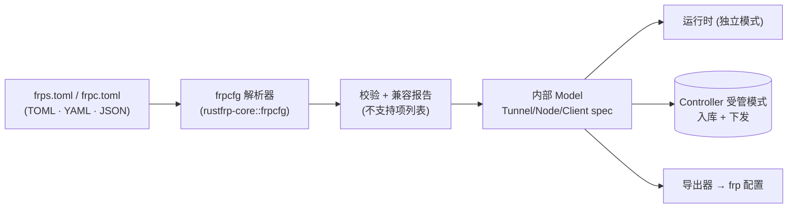
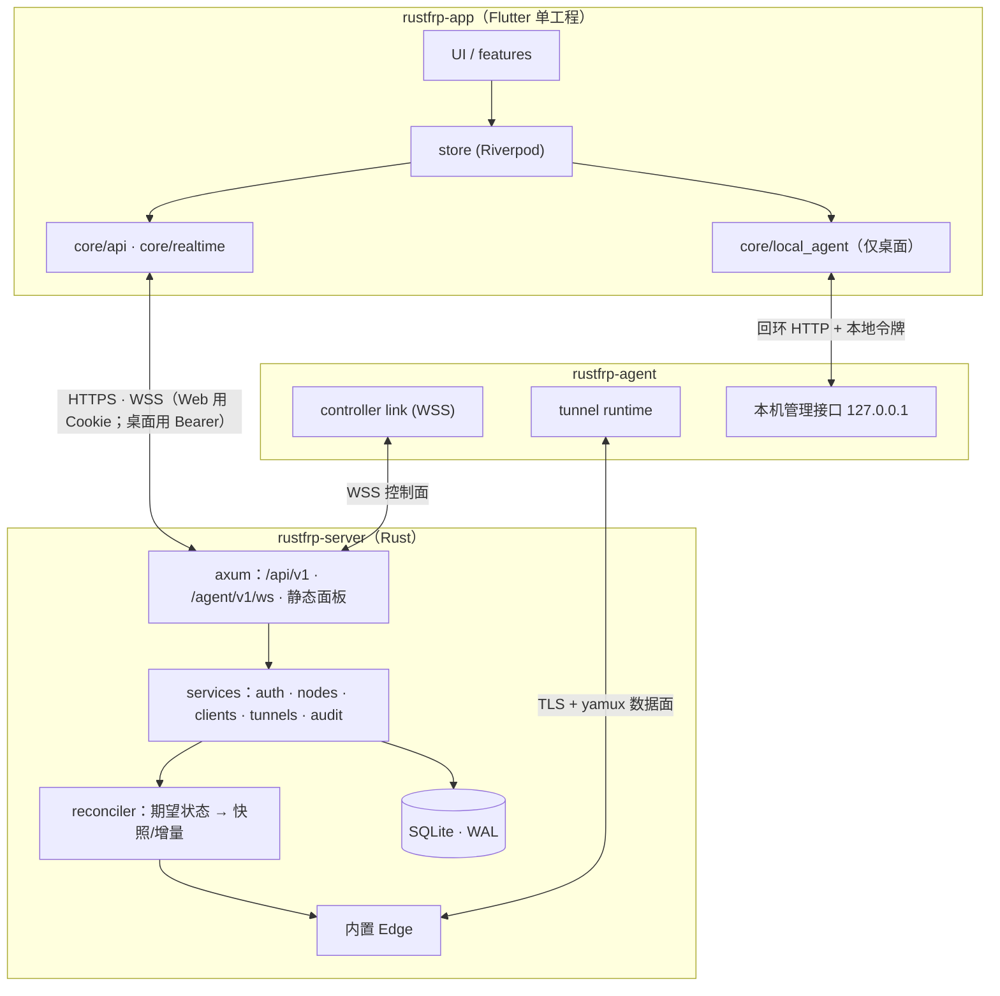
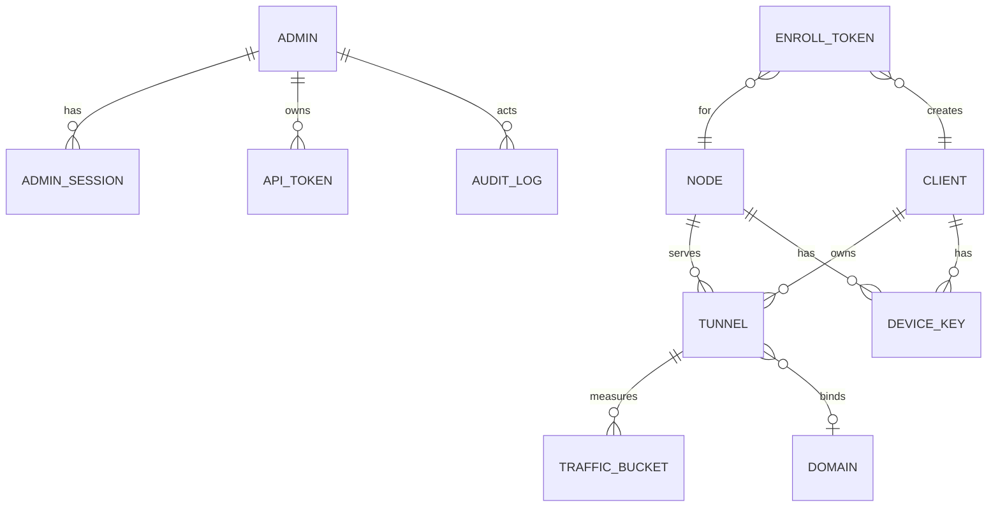
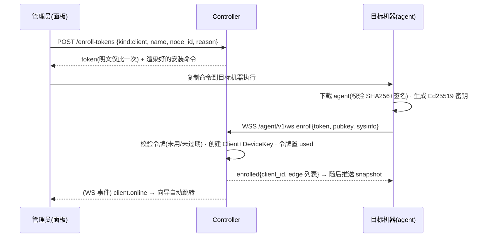

# RustFRP 技术设计文档 V1.0

> 状态：草案，待评审　｜　编制日期：2026-10-11
> 配套文档：[需求说明书](RUSTFRP_PRD_V1.0.md)
> 参考：`/data/www/linkory/` 的 `docs/UI_SPEC.md`、`WEB_DESIGN.md`、`ADMIN_DESIGN.md`、`DEVELOPMENT_PLAN.md` 与 `linkory-app/lib/theme/tokens.dart`。
> 项目名 RustFRP，主域名 `rustfrp.com`（含 `www.`）。
> 本文章节顺序对应交付要求：§1 目标与实施方案 → §2 UI 风格 → §3 多端架构 → §4 Model 设计原则 → §5 目录设计；§6 起为各部分的展开设计。

---

## 0. 整体设计原则（最高优先级）

两条原则凌驾于一切功能与实现取舍之上：任何方案与这两条冲突时，**先改方案，不改原则**。

### 0.1 原则一：极致省内存（Server 与 Agent 一视同仁）

**目标口径**：典型场景（≤10 条隧道、≤100 并发连接）下，`rustfrp-agent`（client 或 edge）常驻 RSS **≈10 MB 以内**；空载 Client ≈4 MB。Controller（含内置 Edge）目标 ≤12 MB。重载场景内存随连接数线性增长、斜率受控（每空闲连接 ≤16 KB），不属于典型口径。以上是**设计目标，由 P01 的实测基线校准**；若某项实测无法达标，需在评审中说明原因并调整，不得悄悄放宽。

**硬性规则**（代码评审必查）：

1. **内存预算先行**：每个新功能在设计里写明「增量内存」；P01 起 CI 内存基准回归，超基线 10% 失败。
2. **默认最小构建**：重功能（QUIC、ACME、Prometheus、插件、TLS 终止）用 Cargo feature，默认关闭；Agent 发布版只带用得到的。
3. **一个连接一个轻任务**：无 per-connection 线程；空闲连接不持有数据缓冲，有数据才从池里租 16 KiB slab。
4. **一个 Client = 一条 TLS 会话 + yamux 多路复用**，访问者连接不各自做 TLS；`https` 类型只读 SNI 透传，不解密（避免每连接数十 KB 的 TLS 状态）。
5. **流式处理，不整包缓冲**：HTTP 只缓冲头部（≤16 KiB，池化）；Body、快照、日志都流式。
6. **有界一切**：连接数、流数、队列、日志环、指标桶、配置体积都有上限，超限拒绝而非增长。
7. **运行时瘦身**：Tokio 工作线程 `min(核数,2~4)`，单核用 `current_thread`；线程栈调小；`mimalloc` 调小保留；Linux `splice` 零拷贝。
8. **存储小**：SQLite `cache_size` 封顶、`mmap_size=0`；面板静态文件预压缩放磁盘/rodata，不进堆。
9. **依赖审查**：新增依赖须评估二进制体积与运行时堆分配；优先轻量实现（如 `lz4_flex` 而非 `zstd`，手写小型解析而非大框架）。
10. **度量可见**：Agent 与面板都显示自身 RSS；`tools/bench/mem.sh` 是一等公民。

### 0.2 原则二：配置层完全兼容 frp（零迁移成本）

**线协议可以自研，配置层必须完全兼容。** 用户拿着现有的 `frps.toml` / `frpc.toml`，换上 RustFRP 二进制就能跑。

1. **同一份配置，同一套语义**。`rustfrp-agent --mode client|edge -c <file>`（及 `frpc` / `frps` 别名、`verify`、`reload` 子命令）读取 frp 原生配置；字段名、默认值、取值范围、校验规则、错误时机都**对齐 frp 主线版本**。
2. **格式全覆盖**：TOML、YAML、JSON；`includes`；环境变量模板 `{{ .Envs.X }}`；`[[proxies]]` / `[[visitors]]`；旧版 INI 经 `convert` 转换。
3. **字段全覆盖**：客户端（`serverAddr/Port`、`auth`、`transport.*`、`proxies`、`visitors`、`webServer`、`metadatas`、`loginFailExit`、`udpPacketSize` 等）与服务端（`bindPort`、`vhost*Port`、`subDomainHost`、`allowPorts`、`maxPortsPerClient`、`transport.*`、`webServer`、`httpPlugins` 等）。
4. **不静默忽略**：暂不支持的字段（如 KCP/QUIC 传输、部分实验特性）→ `verify` 与启动日志列出「字段路径 + 原因 + 替代」；不影响其余配置生效。
5. **线协议不互通是已知代价**：两端须同时迁到 RustFRP。为降低灰度成本，V1.1 评估「frp 线协议兼容模式」（Edge 同时接受官方 frpc）。
6. **导入 / 导出是双向的**：管理面可把 frp 配置导入为受管资源（预览差异→确认），也可导出回标准 frp 配置，保证用户随时可迁出，无锁定。

### 0.3 兼容层的设计（如何同时满足两条原则）



- **frp 配置是「方言」，内部 Model 是「标准」**：解析器把 frp 配置映射成内部 `spec`（见 §4）；内部 Model 对 frp 字段**一一可表达**，frp 特有而内部暂不用的字段进入 `extra`（原样保存、导出时带回），因此导入→导出无损（有往返测试）。
- **独立模式**（无 Controller）直接由解析结果驱动运行，行为等价 frpc/frps；**受管模式**由 Controller 下发同样的 spec。两种模式运行时代码完全一致，不会出现「面板里能配、文件里不能配」的差异。
- **解析器轻量**：用 `serde` 流式反序列化 + 手写校验，不引入大型配置框架；配置在启动后即释放，常驻内存只保留运行必需的结构（落实原则一）。
- **兼容性测试集**：收录 frp 官方示例、文档样例和边界用例（含错误配置），断言「解析结果 / 错误信息 / 默认值」与 frp 一致；CI 必跑；每次 frp 发布新版本时更新并出兼容性差异记录。

---

## 1. 项目目标与实施方案（怎么做）

### 1.1 一句话定位

**Rust 数据面（省内存）+ 自带管理面（可视化集中管理）+ Flutter 一套代码覆盖 Web 面板与三平台桌面客户端。**

### 1.2 核心设计决策

| # | 决策 | 理由 |
|---|---|---|
| D1 | 服务端全部用 **Rust** 实现：Controller、Edge、Client Agent 同属一个 Cargo workspace，共用 `rustfrp-core` | 无 GC、内存可控；三个角色共享协议与多路复用代码，不会漂移 |
| D2 | **Agent 单二进制两种角色**：`--mode client`（frpc）/ `--mode edge`（frps） | 减少发布物；Edge 与 Client 的连接管理、重连、TLS 代码完全复用 |
| D3 | **Controller 内置一个 Edge**，单机一个二进制即可用 | 个人用户一个 VPS 就够；多节点时再扩展独立 Edge |
| D4 | **管理面与数据面分离**：Edge 本地缓存配置，Controller 挂了隧道照常跑 | 管理面是便利，不是单点故障 |
| D5 | 协议**自研**：TLS 之上用多路复用，**服务端主动开流**（不用 frp 的「工作连接池」） | 省去预建连接池的内存与延迟，新建连接 = 开一个流 |
| D6 | 存储用**嵌入式 SQLite**（WAL），不用 MySQL | 单文件、零外部依赖、常驻内存小；管理面数据量级（百~千行）远用不到 MySQL。linkory 用 MySQL 是因为有消息历史，这里没有 |
| D7 | **配置声明式**：面板只修改「期望状态（spec）」，Agent 对账收敛并回报「实际状态（status）」 | 支持热更新、断线重放、幂等 |
| D8 | **Flutter 单工程**：`rustfrp-app` 同时编译 Web（管理面板）与 macOS / Linux / Windows（桌面客户端） | 沿用 linkory 的做法（网页版 = 同一套 Flutter 代码，平台差异用条件导入隔离） |
| D9 | **官网用静态 HTML**（`rustfrp-web`），不用 Flutter | SEO、首屏、体积；视觉复用同一套 token |
| D10 | **不再单独做 React 管理后台**，也**不做独立的「外部端」** | 管理面板即 Flutter Web，由 Controller 同源托管 |

### 1.3 实施方案（分阶段，对应 PRD §8）

每阶段遵循 linkory 的流程：**先改 `rustfrp-protocol` → 再实现 Rust → 再实现 Flutter → 补测试 → 主干保持可运行**。

| 阶段 | 做什么 | 关键产出 | 主要风险与对策 |
|---|---|---|---|
| **P00** | 建 Monorepo、Cargo workspace、`rustfrp-protocol` 骨架、Flutter 工程（含草绿 token 与共享控件）、CI、Makefile | 空壳可编译、可运行 | — |
| **P01** | `rustfrp-core`：TLS 连接 + yamux 多路复用 + 帧编解码；`frpcfg` 配置解析与兼容报告；`rustfrp-agent` 两种角色最小闭环；tcp/udp 代理；**直接读取 frps/frpc.toml 驱动**；内存基线实测 | 两进程跑通 SSH 穿透 | 先做内存基准脚手架，防止后期补救 |
| **P02** | `rustfrp-server`：SQLite 迁移、管理员 CLI、设备接入（令牌→密钥）、配置快照/增量下发、审计、REST + WS | 纯 curl 可管理 | 配置对账的幂等与顺序，写属性测试 |
| **P03** | Flutter Web 面板：登录、概览、节点、客户端、隧道、**接入向导** | 面板闭环 | Web 与桌面的条件导入边界（§3.4） |
| **P04** | HTTP/HTTPS vhost、子域名、证书、Basic Auth、Host 改写、PROXY protocol | S1 场景 | HTTP 解析要流式、零拷贝，不整包缓冲 |
| **P05** | 桌面端：托管本机 agent、托盘、开机启动、控制台模式、三平台打包 | 三平台安装包 | 各系统服务注册与签名（提前验证） |
| **P06** | stcp / sudp / tcpmux、健康检查、负载均衡、限速、插件 | 对照表 P0/P1 全绿 | 限速用令牌桶，不额外起任务 |
| **P07** | 官网、Release 流水线、更新通道、安全审计 | V1.0 | — |

### 1.4 质量门槛（每个 PR）

- `cargo fmt --check` + `cargo clippy -D warnings` + `cargo test`
- `flutter analyze` + `flutter test`（含 golden：宽/窄 × 浅/深）
- **协议 fixtures 一致性测试**（Rust 与 Dart 读同一批 JSON）
- **内存基准回归**：`tools/bench/mem.sh` 跑空载与 1000 连接，超过预算 10% 则 CI 失败

---

## 2. 整体 UI 设计风格

### 2.1 总则：照抄 linkory，只换主色

UI 的颜色、字号、圆角、控件与深浅色沿用 linkory（其本身移植自 cc-switch v7 设计系统），action 主色为草绿。**按用户 2026-10-11 提供的 CC Switch 截图，布局改为可折叠菜单 + 内容区的两栏结构。** 菜单尺寸与间距按该参考调整，其余 token 保持不变。

沿用的规则（原文见 linkory `docs/UI_SPEC.md`，本项目新建同名文档 `docs/UI_SPEC.md` 随代码维护）：

1. 只用 token：颜色 `context.c.xxx`、字号 `Type.xxx`、圆角 `Radii.xxx`；页面代码禁止 `Color(0x…)`、裸字号、裸圆角。
2. 只用共享控件（`shared/widgets.dart`）；缺的先加到共享层。
3. 深浅色都要对；颜色成对使用 `x / xText / xSoft`，不靠透明度推算。
4. 克制：**一个视图最多一个实心主色按钮**；无渐变、无大面积彩色块。
5. 文案中文、简短；错误提示给「原因 + 下一步」。
6. 新页面必须用 `PageHeader`（含桌面窗口按钮与拖拽区）。
7. 不给需要「点一下就响应」的区域加双击手势（避免 300ms 延迟）。

### 2.2 色板（唯一改动处）

只改 `action` 一族 5 个 token，其余与 linkory 逐字节一致：

| Token | 浅色 | 深色 | 说明（linkory 原值 → 本项目） |
|---|---|---|---|
| `action` | `#65A30D` | `#4D7C0F` | 主按钮、选中强调、角标（`#F97316` / `#EA580C`） |
| `actionFg` | `#FFFFFF` | `#FFFFFF` | 不变 |
| `actionHover` | `#4D7C0F` | `#65A30D` | （`#EA620A` / `#F06D1F`） |
| `actionText` | `#3F6212` | `#A3E635` | 绿色文字/链接，浅色下对白底对比度 ≥ 7:1（`#C2410C` / `#FB923C`） |
| `actionSoft` | `#F0F9E1` | `#65A30D` @ 12% | 绿色浅底（`#FFF1E6` / 橙 12%） |

> 草绿取 Tailwind lime 系（色相约 84°，偏黄的草地绿）。白字压在 `#65A30D` 上对比度约 3.4:1，与 linkory 原橙色按钮（约 2.8:1）同级，按钮文字为 13px/600，可接受；若评审认为不足，把浅色 `action` 下调到 `#4D7C0F` 即可，不影响其余 token。

**与语义色 `success` 的区分**（风险 R2）：`success` 保持 linkory 原值（`#16A34A`，色相约 142°，偏蓝的绿）。两者通过以下规则避免混淆：

- `action` 只用于**可点击/选中**（按钮、选中态、链接、角标）；`success` 只用于**状态**（在线点、完成徽标）。
- 状态一律「圆点/图标 + 文字」，不单靠颜色表达。
- 图表里「流量」类数据系列不使用 `action`，用 `direct`（蓝）与 `warning`；绿色仅表示健康。

其余 token（`bgApp / bgSidebar / bgSubtle / bgSelected / bgCard / border / borderStrong / text1-3 / controlOff / direct / success / warning / danger / overlay / shadow*`）、字体回退链、`Type.*`（11/12/13/14/15/16/18/24）、`Radii`（6 / 10 / 14）全部原样复制。

### 2.3 布局：两栏（按用户提供的 CC Switch 截图）

```
┌──────────────────────┬────────────────────────────────────┐
│ 可折叠菜单            │ 自适应内容工作区                     │
│ 展开 200px            │ PageHeader 52px                     │
│ 收起 72px             │ 列表 / 详情 / 筛选 / 设置分类         │
└──────────────────────┴────────────────────────────────────┘
```

- 菜单顶部为品牌与展开/收起按钮；主功能在上部，连接状态与设置在下部。
- 菜单行高 28px、文字 `Type.body`（13px）、图标 18px、图标与文字间距 8px。菜单文字统一常规字重，选中态只改背景与颜色。收起后保留图标与 tooltip。
- 菜单折叠状态记入用户偏好，页面切换和应用重开后保持。
- 不再有固定 280px 中间列表栏。客户端在工作区内从列表进入详情，详情有返回列表按钮；节点直接展示当前内置节点。
- 隧道状态筛选在内容区顶部，设置分类采用内容区顶部横向导航。
- 内容继续使用 `PageHeader`、共享控件与原有 token；颜色、字体大小与圆角不变。
- 窄屏（<720）保留单栏、底部导航和详情压栈。

### 2.4 导航与页面

| 菜单 | 工作区 | 备注 |
|---|---|---|
| 概览 | 指标卡、节点信息、最近客户端 | 无中间列表 |
| 节点 | 当前内置节点详情 | 窄屏保留节点列表入口 |
| 客户端 | 全宽列表 → 全宽设备详情 | 详情可返回列表，接入向导与管理操作保留 |
| 隧道 | 顶部筛选 + 隧道卡片 | TCP / UDP / HTTP / HTTPS 行为不变 |
| 审计 | 审计记录 | 按角色隐藏 |
| 设置 | 顶部分类 + 对应设置页 | 分类按角色隐藏 |
| 本机模式（桌面） | 本机连接、状态与启停 | 与控制台共用两栏菜单组件 |

**接入向导**（M-05，页头「接入新客户端」触发 `LDialog`）：① 选平台（macOS / Linux / Windows，自动按当前浏览器 OS 预选）→ ② 命名、选节点、可选标签 → ③ 展示一次性接入命令（带复制按钮）与下载链接 → ④ 实时等待上线（订阅 WS 事件，成功后自动跳转到该客户端详情）。令牌默认 1 小时有效，用后即焚。

**未登录 / 空状态**：沿用 linkory「浏览模式」思想——应用不强制登录即可看到完整界面骨架，依赖账号的区域给「说明 + 登录入口」（`GuestBanner` / `GuestEmpty`）。

### 2.5 共享控件清单（沿用并按需扩展）

沿用：`LButton`（solid/neutral/quiet/ghost/destructive × 32/28）、`LIconButton`、`LTextField`、`LSelect`、`LSwitch`、`LBadge`、`PanelCard`、`LDialog`/`ConfirmDialog`、`HoverRow`、`PageHeader`、`DragArea`、`WindowControls`、`DeviceGlyph`、`BrandLogo`、`GuestBanner`/`GuestEmpty`、`ReleaseNotes`、`UpdateSourcePicker`、SnackBar。

新增（均在 `shared/` 内，遵循同样 token）：

| 控件 | 用途 |
|---|---|
| `StatusDot` | 8/11px 状态点：online=success、connecting=warning、offline=text3、error=danger |
| `MetricCard` | 指标卡：`Type.metric` 数字 + `Type.caption` 标签 + 可选迷你趋势 |
| `Sparkline` / `TrafficChart` | 折线与面积图；系列色取 `direct`/`warning`，网格线 `border` |
| `DataTable` | 紧凑表格：32px 行高、`HoverRow`、粘性表头、窄屏降级为卡片列表 |
| `CopyField` | 只读等宽文本 + 复制按钮（接入命令、公网地址） |
| `CodeBlock` | 等宽字体回退链须含中文回退（沿用 linkory 约束） |
| `Stepper` | 接入向导步骤条 |
| `TunnelTypeBadge` | tcp/udp/http/https/stcp… 的类型徽标 |

### 2.6 品牌

Logo 沿用 linkory 的结构（28×28 圆角方块 + 白色图形，固定品牌色），图形为一笔贯通的倾斜双环，两个闭合环表示内外网，中心连接表示隧道互通；底色为以 `#65A30D` 为主色的草绿渐变。品牌资源放 `assets/brand/`（SVG 母版 + 多尺寸 PNG + 单色版），由 `tools/gen_icons.py` 生成各平台图标（沿用 linkory 做法）。

---

## 3. 多端技术架构

### 3.1 端与产物

| 端 | 技术 | 产物 | 角色 |
|---|---|---|---|
| Controller | Rust | `rustfrp-server`（Linux/macOS/Windows，x64/arm64） | 管理面 + 内置 Edge + 托管 Web 面板 |
| Edge | Rust | `rustfrp-agent --mode edge` | 数据面，可多节点 |
| Client Agent | Rust | `rustfrp-agent --mode client` | 内网机器上的隧道客户端 |
| Web 面板 | Flutter Web | `build/web`（由 Controller 托管在 `/`） | 管理员 |
| 桌面客户端 | Flutter Desktop | `.dmg` / `setup.exe`+zip / `.deb`+tar.gz | 本机 agent 管理 + 管理控制台 |
| 官方网站 | 静态 HTML/CSS/JS | `rustfrp-web/`（自有服务器 nginx，`rustfrp.com` / `www.rustfrp.com`） | 介绍、下载、文档入口 |

> 移动端（Android / iOS）：Flutter 工程保留 `android/` `ios/` 目录能力但 V1.0 不启用；V2.0 评估。

### 3.2 总体架构



两条独立通道，职责不混：

- **控制面**（Agent ↔ Controller）：WSS，JSON 消息。接入、配置快照/增量、状态与指标上报、命令（重启、更新、断开）。
- **数据面**（Client Agent ↔ Edge）：TLS（ALPN `rfrp/1`）+ yamux 多路复用。流 0 为握手与保活；Edge 收到访问者连接时**主动向 Client 开一条新流**，首帧携带 `tunnel_id` 与访问者地址，Client 连本地目标后双向 `copy`。

内置 Edge 与 Controller 共用监听端口（按 ALPN / HTTP Upgrade 路径分流），因此单机只需开放一个入口端口（默认 7000/TCP）加用户隧道端口。

### 3.3 桌面端两种模式

同一个桌面 App 内，登录后进入哪种模式取决于账号类型，二者共用 `shell` 与大部分页面：

| 模式 | 触发 | 数据来源 | 可见导航 |
|---|---|---|---|
| **本机模式** | 用接入令牌接入、或选择「仅管理本机」 | 本机 agent 的回环管理接口 + Controller（经 agent 代理） | 概览 / 隧道 / 日志 / 设置 |
| **控制台模式** | 用管理员账号登录 Controller | Controller REST + WS | 概览 / 节点 / 客户端 / 隧道 / 审计 / 设置（与 Web 一致） |

本机受管 agent 独立后台运行，**关闭界面不停止隧道**。桌面通过仅当前用户可读的发现文件重新连接它：

- 仅监听 `127.0.0.1:<随机端口>`，采用有界、带本地令牌的 JSON 控制请求（非 HTTP，浏览器不能直接调用）。协议与共享 fixture 见 `rustfrp-protocol/LOCAL_CONTROL.md`。
- macOS 首次用令牌接入并保存身份，然后交给 `launchd bootstrap gui/<uid>`；服务定义放在用户状态目录，**不含接入令牌**。Linux / Windows 使用独立后台进程，尚需实机验收。
- 关闭窗口只关闭界面，重开恢复原进程的状态；仅显式「停止」发出带本地令牌的停止请求，不通过 PID 强杀。
- 当前实现为受管本机连接、状态与启停。系统开机启动、托盘、本地 frp 配置编辑、日志页、应用更新和安装包仍待后续阶段完成；目前不向系统登录启动目录写入服务定义。
- 设计增量内存：仅在显式 `--local-control` 时分配监听器、几个状态标量和约 2 KiB 请求缓冲；请求串行处理，读写 2 秒超时，无额外 per-connection 线程或无界容器。

### 3.4 Flutter 平台差异隔离

沿用 linkory `core/web/` 的条件导入模式：

```
core/platform/
  platform.dart          # 抽象接口 + 条件导出
  platform_io.dart       # 桌面实现（dart:io、window_manager、tray_manager、本机 agent）
  platform_web.dart      # Web 实现（package:web、Web Locks 单标签页、Cookie 会话）
  platform_stub.dart     # 测试/其它
```

| 能力 | 桌面 | Web |
|---|---|---|
| 凭据存储 | `flutter_secure_storage`（Keychain / Credential Manager / libsecret） | HttpOnly Cookie（服务端设置，脚本不可读）；仅 UI 偏好用 localStorage |
| 管理会话 | Bearer（短期 access + 可轮换 refresh） | Cookie + `X-CSRF-Token` + 同源 Origin 校验 |
| 实时事件 | WebSocket | WebSocket（同源，Origin 校验天然通过） |
| 本机 agent | ✅ | ❌（隐藏入口） |
| 托盘 / 开机启动 / 更新 / 窗口控制 | ✅ | ❌（隐藏） |
| 多标签页 | — | Web Locks 互斥，非活动标签页只读提示（沿用 linkory） |
| 构建 | `flutter build macos|linux|windows` | `flutter build web --release --wasm`，**CanvasKit 随包、不依赖外部 CDN**，内置中文字体 |

Web 面板路径前缀可配置（`RUSTFRP_WEB_PREFIX`，默认 `/`），Controller 返回 `index.html` 时改写 `<base href>`（沿用 linkory 做法），API 始终在 `/api/v1`，不受影响。

### 3.5 Controller 托管面板

- `RUSTFRP_PANEL_DIR` 指向 `build/web`（或编译时 `embed-panel` feature 内嵌，预压缩 brotli，运行时按需读取，不常驻堆内存）。
- 安全头：严格 CSP（`default-src 'self'; script-src 'self' 'wasm-unsafe-eval'; connect-src 'self'; img-src 'self' data: blob:; style-src 'self' 'unsafe-inline'; font-src 'self' data:`）、`frame-ancestors 'none'`、`X-Content-Type-Options`、`Referrer-Policy`。
- API 同源，**不开 CORS 例外**。
- 默认监听 `127.0.0.1`；公网暴露需显式配置并强制 HTTPS（风险 R6）。

---

## 4. Model 设计原则

### 4.1 原则

**P1　协议是唯一来源。** 所有跨进程的数据结构定义在 `rustfrp-protocol/`（OpenAPI + JSON Schema + `PROTOCOL.md`）。Rust（`rustfrp-core::proto`）与 Dart（`core/models/`）各自实现，但都必须通过**同一批 fixtures**（`rustfrp-protocol/fixtures/*.json`）的往返测试。改 Model 的顺序固定：协议 → Rust → Dart。

**P2　期望状态与实际状态分离（spec / status）。** 每个可配置资源（Tunnel、Node 配置、Client 配置）拆成 `spec`（用户意图，只由管理面写）和 `status`（运行事实，只由 Agent 回报写）。永远不混写一个字段，避免「谁说了算」的冲突。

**P3　标识符与时间。** 主键用 **UUIDv7 / ULID**（时间有序、可在 Agent 本地预生成、无需中心发号）；对外展示的名称与 ID 分离，名称可改、ID 不可变。所有时间为 **UTC 毫秒整数（i64）**，传输中不用本地时区字符串；展示层才格式化。

**P4　版本化与幂等。** 每个作用域（每个 Edge、每个 Client）维护单调递增的 `revision`（u64）。下发 = 全量快照（`revision=N`）+ 增量（`N→N+1`，`upsert/remove` 按 ID）；Agent 回报 `applied_revision`。所有变更操作带 `request_id`，重复提交返回同一结果。

**P5　显式枚举，向前兼容。** 枚举在 Rust 用 `#[serde(other)]` 兜底 `Unknown`，在 Dart 用 `fromWire` 返回 `unknown`。**新增枚举值是兼容变更；删除或改名是破坏变更**，需要升协议大版本。未知字段一律忽略，不报错。

**P6　不可变与值语义（Dart）。** Model 全部 `@immutable`、`final` 字段、`copyWith`、`==`/`hashCode`；列表字段用不可修改视图。Store 只通过替换整个对象更新状态，UI 不直接改 Model。

**P7　敏感信息不进通用 Model。** 令牌、共享密钥、私钥、密码哈希存放在独立表/独立类型（`SecretRef`），**默认序列化时输出 `null`/占位**；只有「创建/轮换」那一次响应带明文。日志与审计的 Model 中不允许有这类字段（类型层面做不到引用）。

**P8　软删除与审计不可改。** 业务资源删除 = 设 `deleted_at`（保留引用完整性，到期由清理任务物理删除）；`audit_log` 只追加、不更新；审计里的目标用独立 `target_id` 字符串保存，资源物理删除后仍可追溯。

**P9　状态机显式化。** 有生命周期的对象（Client 接入、Tunnel 运行、接入令牌）定义**合法迁移表**，服务端原子校验，非法迁移返回 `409`。禁止用布尔字段堆叠状态（反例：`is_online && !is_error`）。

**P10　尺寸有界。** 所有字符串/列表有上限（名称 ≤ 64、标签 ≤ 16 个、单次快照 ≤ 1 MiB）；指标不存逐连接记录，只存聚合（每隧道每分钟一个桶），避免数据膨胀吃内存与磁盘。

**P11　UI 视图模型与传输模型分层。** 传输模型（`models/*.dart`，与协议一一对应）≠ 视图模型（`features/*/view_models`）。例如 `TunnelView` 可组合 `Tunnel + TunnelStatus + Node.publicAddr` 并生成「公网地址」展示串；协议改动只影响前者。

### 4.2 核心实体



| 实体 | 主要字段（spec / status 分栏） | 说明 |
|---|---|---|
| `Admin` | id, name, role(Owner/Admin/Operator/Viewer), password_hash, disabled_at | 不是 Client，不注册为设备；仅 CLI 创建 |
| `AdminSession` / `ApiToken` | token_hash, expires_at, scope | 只存哈希；会话最长 8h |
| `Node`（Edge） | **spec**：name, public_host, bind_port, allow_ports[], vhost_http_port, vhost_https_port, subdomain_suffix, labels / **status**：state, version, os, arch, last_seen, rss_bytes, conns, applied_revision | 内置 Edge 是一条 `builtin=true` 的 Node |
| `Client` | **spec**：name, labels, node_id（默认接入节点）, disabled_at / **status**：state, version, os, arch, ip, last_seen, applied_revision | |
| `DeviceKey` | owner_kind, owner_id, ed25519_pubkey, created_at, revoked_at | 一个设备可轮换多个密钥 |
| `EnrollToken` | token_hash, kind(client/node), node_id, name, expires_at, used_at | 一次性；用后 `used_at` 非空 |
| `Tunnel` | **spec**：name, client_id, node_id, type, local_addr, remote_port / domains[] / subdomain, options{encrypt,compress,bandwidth,proxy_protocol,health_check,group,plugin,http{basic_auth,host_rewrite,headers,locations}}, enabled / **status**：state(pending/starting/running/error/stopped), error, conns, bytes_in, bytes_out, applied_revision | `options` 存 JSON，Schema 约束；`type` 决定哪些字段必填 |
| `Domain` | host, tls_cert_ref, tls_key_ref, node_id | 证书私钥走 `SecretRef` |
| `TrafficBucket` | tunnel_id, minute_ts, bytes_in, bytes_out, conns_peak | 聚合桶，按保留策略清理 |
| `AuditLog` | id, ts, actor_kind, actor_id, action, target_kind, target_id, reason, result, ip | 只追加；写入失败则操作失败 |
| `Policy` | key, value(JSON) | 数据保留期、端口保留、登录限流等 |

状态机（节选）：

```
Tunnel.status.state:  pending → starting → running ⇄ error ;  任意 → stopped (enabled=false)
Client.status.state:  offline ⇄ online ;  disabled（spec.disabled_at 非空，终态直到启用）
EnrollToken:          issued → used | expired | revoked
```

### 4.3 命名与序列化约定

- JSON 字段 `snake_case`；枚举值 `snake_case` 字符串；时间字段后缀 `_at`（毫秒时间戳）；时长后缀 `_ms`；字节后缀 `_bytes`。
- Rust：`serde` + `deny_unknown_fields` **仅用于**内部持久化结构，对外协议结构不用（P5）。
- Dart：`fromJson` 对缺失/类型错误字段给默认值或抛 `ProtocolException`（带字段路径），**不吞错**。
- ID 在 URL 中用字符串，不暴露自增序号。

---

## 5. 目录设计

### 5.1 Monorepo 总览（沿用 linkory：一级目录加前缀、各自独立构建与测试）

```text
RustFRP/
├── Cargo.toml                  # Cargo workspace（成员：rustfrp-core / -server / -agent / -cli-tests）
├── rustfrp-core/               # Rust 共享库（含 frpcfg：frp 配置解析/校验/导出）
├── rustfrp-server/             # Controller（含内置 Edge、托管面板）
├── rustfrp-agent/              # Agent（client / edge 双角色）
├── rustfrp-protocol/           # 协议唯一来源
├── rustfrp-app/                # Flutter：Web 面板 + 三平台桌面
├── rustfrp-web/                # 官方网站（静态）
├── deploy/                     # Docker Compose / systemd / 环境变量样例
├── installer/                  # Windows(Inno Setup) / Linux(.deb) / macOS(dmg 脚本) / install.sh / install.ps1
├── assets/brand/               # Logo 母版与多尺寸资源
├── tools/                      # 开发、联调、基准、打包、图标生成脚本
├── docs/                       # PRD、技术设计、UI_SPEC、协议、部署、安全审计
├── .github/workflows/          # CI 与 Release
├── AGENTS.md  CLAUDE.md        # AI 协作约定（命令清单、架构要点）
├── Makefile                    # 统一入口
├── README.md  README.en.md  LICENSE
```

### 5.2 `rustfrp-core/` — Rust 共享库

只放**三个角色都要用**的代码，不含业务策略；无 `unsafe` 之外的平台特定代码集中在 `sys/`。

```text
rustfrp-core/
├── Cargo.toml
└── src/
    ├── lib.rs
    ├── frpcfg/           # ★ frp 配置兼容层：解析(TOML/YAML/JSON/includes/模板)、校验、兼容报告、导出
    │   ├── client.rs  server.rs  proxy.rs  visitor.rs  compat.rs  export.rs
    ├── proto/            # 线上消息结构（与 rustfrp-protocol 对应）
    │   ├── control.rs    #   控制面 WS 消息（snapshot/delta/status/command）
    │   ├── wire.rs       #   数据面帧：握手、OpenStream、保活
    │   ├── model.rs      #   Tunnel / Node / Client 的 spec 与 status
    │   └── error.rs      #   错误码
    ├── transport/        # TLS 配置、ALPN、yamux 封装（trait 隔离，可换 QUIC）
    ├── mux/              # 会话管理、流打开/接受、背压
    ├── crypto/           # Ed25519 签名/验签、令牌哈希、可选 ChaCha20-Poly1305
    ├── pipe/             # 双向拷贝：Linux splice 快路径、通用 copy 回落、限速令牌桶
    ├── buf/              # 缓冲池（按需分配、定长 slab）
    ├── reconcile/        # 对账引擎：期望 → 实际（Agent 与 Edge 共用）
    ├── backoff.rs        # 指数退避 + 抖动
    ├── metrics.rs        # 无锁计数器聚合
    └── sys/              # 平台差异：服务注册、路径、信号
```

### 5.3 `rustfrp-server/` — Controller

模块化单体，沿用 linkory 的 `internal/` 分层思想（一个模块 = 一个领域，对外只暴露 service trait）。

```text
rustfrp-server/
├── Cargo.toml
├── migrations/                 # 0001_init.sql … 启动时自动迁移（内嵌）
├── src/
│   ├── main.rs                 # 入口：解析参数，子命令分发
│   ├── cli/                    # `run`、`admin create|disable|passwd|list`、`backup`、`migrate`
│   ├── config.rs               # 环境变量 + 配置文件
│   ├── db/                     # SQLite 连接（单写线程 + 小读池）、迁移、事务封装
│   ├── http/                   # axum 路由、中间件（鉴权/CSRF/限流/审计）、静态面板、安全头
│   │   ├── api_v1/             #   REST：auth / nodes / clients / tunnels / enroll / audit / admins / tokens / policy
│   │   └── agent_ws.rs         #   /agent/v1/ws：Agent 控制面入口
│   ├── services/
│   │   ├── auth/               #   管理员、会话、API Token、限流
│   │   ├── nodes/              #   节点 CRUD、端口分配、接入
│   │   ├── clients/            #   客户端 CRUD、状态机
│   │   ├── tunnels/            #   隧道校验（端口冲突/域名冲突/白名单）、模板
│   │   ├── enroll/             #   接入令牌、安装命令渲染
│   │   ├── audit/              #   审计（与业务写入同事务）
│   │   └── retention/          #   数据保留与分批清理 worker
│   ├── reconciler.rs           # 期望状态 → 快照/增量 → 推送给 Agent/Edge，处理 ack
│   ├── hub.rs                  # 在线 Agent 连接表、事件广播（给面板 WS）
│   ├── edge_embedded.rs        # 内置 Edge（进程内直连 hub，免网络）
│   └── metrics.rs              # 聚合、落桶、Prometheus（可选 feature）
└── tests/                      # 集成测试：真实 SQLite + 真实 WS + 假 Agent
```

关键约束：

- **数据库访问只在 `services/*` 内部**，`http/` 不拼 SQL。
- **审计与业务写入同事务**，审计失败整体回滚。
- 管理员只能经 CLI 创建，**无默认账号、无注册接口**。
- 所有写 API 要求非空 `reason`（便于审计）；删除类要求预览 ID + 确认文本（沿用 linkory 的二次确认）。

### 5.4 `rustfrp-agent/` — Agent（client / edge）

```text
rustfrp-agent/
├── Cargo.toml
└── src/
    ├── main.rs                 # clap：run（-c frp 配置）/ verify / reload / convert / enroll / service / status / version；frpc、frps 别名
    ├── mode/
    │   ├── client/             # frpc 角色：连 Edge 开流、连本地目标、visitor（stcp/sudp）
    │   └── edge/               # frps 角色：监听公网端口、vhost 路由、接受 Client 会话、开流
    ├── controller_link.rs      # 与 Controller 的 WSS：接入、拉快照、收增量、回报
    ├── enroll.rs               # 令牌换身份；密钥生成与安全存放
    ├── runtime/                # 隧道运行时：tcp / udp / http / https / stcp / sudp / tcpmux
    ├── plugins/                # socks5 / http_proxy / static_file / https2http
    ├── vhost/                  # HTTP Host 解析（流式、零拷贝）、SNI 解析
    ├── local_api.rs            # 回环管理接口（给桌面 App；仅 client 模式）
    ├── standalone.rs           # 无 Controller：读本地 TOML
    ├── import_export.rs        # 与 Controller 的 frp 配置导入/导出（解析在 core::frpcfg）
    ├── service/                # systemd / launchd / Windows Service 注册
    └── update.rs               # 下载、签名校验、替换、重启
```

### 5.5 `rustfrp-protocol/` — 协议唯一来源

```text
rustfrp-protocol/
├── PROTOCOL.md                 # 人类可读：握手、状态机、版本协商、错误码
├── openapi.yaml                # /api/v1 管理 REST
├── schemas/                    # JSON Schema：控制面消息、模型、tunnel options
│   ├── control.schema.json
│   ├── models.schema.json
│   └── tunnel_options.schema.json
├── frp-compat/                 # 兼容性测试集：frp 官方样例/边界配置 + 期望解析结果与错误
├── fixtures/                   # 黄金样例（Rust 与 Dart 测试共同读取）
│   ├── tunnel_tcp.json  tunnel_http.json  snapshot.json  delta.json  status.json …
└── CHANGELOG.md                # 协议变更记录（兼容/破坏标注）
```

### 5.6 `rustfrp-app/` — Flutter 单工程（Web + 三平台桌面）

结构直接沿用 `linkory-app/lib`：`app / core / shared / theme / features`。

```text
rustfrp-app/
├── pubspec.yaml                # riverpod、http、web_socket_channel、window_manager、tray_manager、
│                               # local_notifier、flutter_secure_storage、lucide_icons_flutter、
│                               # flutter_markdown_plus、url_launcher、file_picker …（与 linkory 一致）
├── lib/
│   ├── main.dart
│   ├── app/app.dart            # MaterialApp、主题、路由、窗口圆角包装
│   ├── theme/tokens.dart       # ★ 唯一改动：action 一族换草绿（§2.2）；其余与 linkory 逐字节一致
│   ├── shared/                 # 共享控件与格式化：widgets.dart、format.dart、rounded_window.dart、
│   │                           #   close_dialog.dart、charts.dart、data_table.dart …
│   ├── core/
│   │   ├── models/             # 传输模型（对应 protocol）：tunnel.dart node.dart client.dart admin.dart …
│   │   ├── api.dart            # REST 客户端（统一错误、CSRF/Bearer 注入）
│   │   ├── realtime.dart       # 面板 WS（事件订阅、断线重连）
│   │   ├── store.dart          # 全局 AppStore（Riverpod）：section、选中项、连接状态
│   │   ├── session.dart        # 登录态、模式（本机/控制台）
│   │   ├── secrets.dart        # 凭据存储（条件实现）
│   │   ├── platform/           # 条件导入隔离（§3.4）
│   │   ├── local_agent/        # 桌面：本机 agent 发现、安装服务、回环 API 客户端
│   │   ├── updater.dart  update_install.dart  version.dart  log.dart
│   │   └── desktop.dart        # 托盘、开机启动、窗口管理
│   └── features/
│       ├── shell/              # 三栏/窄屏壳、图标栏、底部导航、toast
│       ├── auth/               # 登录页/对话框、Controller 地址选择
│       ├── dashboard/          # 概览
│       ├── nodes/              # 节点列表与详情、接入新节点
│       ├── clients/            # 客户端列表与详情
│       ├── tunnels/            # 隧道列表、编辑抽屉、模板
│       ├── enroll/             # 接入向导（客户端/节点共用）
│       ├── audit/              # 审计
│       ├── logs/               # 日志尾随
│       ├── local/              # 本机模式：本机概览、本机隧道
│       ├── settings/           # 账号、管理员、令牌、通用、更新、关于
│       ├── update/             # 更新对话框
│       └── guest/              # 未登录浏览模式
├── web/                        # index.html、manifest、内置中文字体（NotoSansSC）
├── macos/ linux/ windows/      # 桌面 runner（Linux/Windows 窗口圆角沿用 linkory 实现）
├── test/                       # 单测、widget、golden（宽/窄 × 浅/深）、fixtures 一致性
├── integration_test/
└── assets/
```

### 5.7 `rustfrp-web/` — 官方网站（静态）

```text
rustfrp-web/
├── index.html                  # 首屏：一句话定位、特性、对比 frp（内存/管理）、截图
├── download.html               # 按 OS 自动高亮；链接指向 GitHub Release（含「国内加速」）
├── docs.html                   # 文档入口（链接 docs/ 与快速开始）
├── privacy.html  terms.html
├── styles.css                  # 与 App 同一套 token（草绿主色，深浅色自适应）
├── script.js                   # OS 检测、最新版本获取（带缓存与降级）
├── assets/                     # 截图（宽/窄 × 浅/深）、logo
├── nginx.conf.example         # 自有服务器部署样例（HTTPS、缓存头、www 跳转）
└── tests/                      # 下载逻辑单测
```

### 5.8 其余目录

| 目录 | 内容 |
|---|---|
| `deploy/` | `docker-compose.yml`（单服务 + 卷）、`.env.example`、`rustfrp-server.service`、反向代理 nginx/caddy 样例（`/` 面板 + `/api` + `/agent` WS） |
| `installer/` | `windows/*.iss`、`linux/deb/`、`macos/dmg.sh`、`install.sh`（`curl … \| sh`，校验 SHA256 与签名）、`install.ps1` |
| `tools/` | `server_run.sh`、`app_run.sh`、`web_run.sh`、`bench/mem.sh`（内存基准）、`bench/throughput.sh`、`gen_icons.py`、`package_macos.sh`、`deploy_*.sh`、`e2e/`（假 Agent + 真 Controller 的端到端） |
| `docs/` | `RUSTFRP_PRD_V1.0.md`、`RUSTFRP_TECH_DESIGN_V1.0.md`、`UI_SPEC.md`、`ADMIN_DESIGN.md`（权限与审计）、`DEPLOYMENT.md`、`SECURITY_AUDIT_*.md`、`images/` |
| `.github/workflows/` | `ci.yml`（fmt/clippy/test/analyze/基准）、`release.yml`（`v*` 标签 → 多平台构建 → 签名 → SHA256SUMS(+sig) → Release） |

### 5.9 Makefile 入口（沿用 linkory 风格）

```make
server-run / server-test      # cargo run -p rustfrp-server / cargo test
agent-run MODE=client|edge
core-test                     # cargo test -p rustfrp-core
app-run [DEVICE=…] / app-test # flutter run / flutter analyze + test
web-build                     # flutter build web --wasm → rustfrp-server 托管
web-run                       # 本机起 Controller 并打开浏览器
bench-mem                     # 内存基准
e2e                           # 端到端
package-macos-dmg / package-win / package-deb
up / down                     # docker compose
```

---

## 6. 数据面与控制面关键流程

### 6.1 接入新客户端



之后每次重连：Agent 用私钥对服务端 challenge 签名认证（不再用令牌）。

### 6.2 隧道建立与转发

1. 管理员保存隧道（`spec`）→ Controller 校验（端口白名单/冲突、域名冲突、客户端与节点状态）→ 同事务写库 + 审计 → `revision++`。
2. Reconciler 向相关 Client 与 Edge 推送 **delta**；二者各自对账：Edge 开始监听（或更新路由表），Client 记录目标。
3. 访问者连接 Edge 公网端口 → Edge 向该 Client 会话**开新流**，首帧 `OpenStream{tunnel_id, peer_addr, proxy_proto?}` → Client 连本地目标 → 双向 `pipe`（Linux 优先 `splice`）。
4. 双方上报 `status`（state、conns、bytes）；Controller 聚合入 `traffic_bucket`。

热更新：对账只对**有差异的隧道**重启监听/路由；未变更的隧道和其上长连接不受影响（AT-04）。

### 6.3 Controller 不可用

Edge 与 Client 持久化「最后一份已确认快照」（`state_dir/last_snapshot.json`，原子写）。启动时若连不上 Controller，用缓存配置先跑起来，后台持续重连。设备认证用 Edge 本地缓存的公钥列表，因此无需 Controller 在线。

**实现补充（节点协议，`rustfrp-core::node`）**：外置 Edge 经 Controller 的节点端口接入——一条 TLS 连接，帧同 `wire`（4 字节长度 + JSON，≤ 64 KiB）。
Controller 先发 `Challenge{nonce}`，节点用身份密钥签名应答 `Hello`，首次接入则带一次性令牌（`kind=node`）。随后 Controller 逐条下发设备
（`SnapshotBegin → Device* → SnapshotEnd`，之后是 `Device/Remove/Kick` 增量），节点回报 `Online/Offline/Proxy/Resync/Traffic`，
并把设备的首次接入请求（`Enroll`）转交 Controller。节点设备名册持久化到状态目录，登录只查本地名册，所以 Controller 不在线时数据面与设备重连都不受影响。

### 6.4 HTTP / HTTPS 路由

- `http`：Edge 读取请求头直到 Host（流式、最多 16 KiB 头部缓冲，池化），按 `域名 + 路径最长前缀` 匹配隧道；Basic Auth、Host 改写、自定义头在转发前对**头部**处理，Body 不缓冲。
- `https`：只解析 TLS ClientHello 的 SNI，**不解密**，按 SNI 选隧道后原样转发。
- 同端口复用：80/443 可与其它 TCP 隧道分流（P1）。

**实现补充（http 逐请求路由）**：`rustfrp-core::http1` 用 `httparse` 严格解析请求头（拒绝 Content-Length 与 Transfer-Encoding 并存、冲突的 Content-Length、重复 Host、非 chunked 结尾的 TE、CONNECT），`ChunkedScanner` 只数边界不缓冲正文，因此**保持连接上的每个请求都独立选路与鉴权**：同域名下按「最长路径前缀 → 与请求 Basic 用户名一致的 `routeByHTTPUser` → 未限定用户」选路（同 frp），Basic Auth 在 Edge 校验（定时无关比较），`requestHeaders.set` / Host 改写只作用于头部。一个访问者连接最多同时连 8 条后端流（不同路由各一条）；切换后端前，`ResponseTracker` 观察上一条后端的响应并等它完整送完，保证流水线请求的响应顺序；无法判定边界（协议升级、畸形响应）时关闭连接而不是冒险乱序。`Upgrade`（WebSocket）在头之后转为原样透传。尚未实现 `responseHeaders` 与 PROXY protocol。

---

## 7. 内存优化方案（落实 PRD §6.1）

| 手段 | 做法 |
|---|---|
| 运行时 | Tokio；工作线程数 = `min(核数, 4)`，Agent 在单核环境用 `current_thread`；`max_blocking_threads` 小值 |
| 分配器 | 默认 `mimalloc`（`MIMALLOC_*` 调小保留）；musl 构建验证；Cargo feature 可切 `jemalloc` |
| 每连接开销 | 一个任务 + 一个 yamux 流，**无 per-connection 线程**；拷贝缓冲 **按需租用**（空闲连接不持有缓冲，读到数据才从池里取，16 KiB slab） |
| 零拷贝 | Linux 上 `splice` 经 pipe 直接内核转发；其它系统回落通用 copy |
| 多路复用窗口 | yamux 每流窗口上限调小（默认 256 KiB → 64 KiB 可配），限制全局最大并发流 |
| 序列化 | 控制面 JSON 消息体小且低频；数据面帧头定长二进制；快照流式解析（`serde` 不整体 `Value`） |
| SQLite | `cache_size` 封顶（如 2 MiB）、`mmap_size=0`、WAL + 定期 checkpoint、读连接池 ≤ 2 |
| 指标 | 无锁原子计数器，按分钟聚合；不保留逐连接记录；日志环形缓冲定长 |
| 面板静态资源 | 预压缩 + 磁盘/内嵌 rodata，按需读取，不进堆 |
| 依赖与二进制 | 默认关闭重功能 feature（QUIC、ACME、Prometheus、插件）；`opt-level="z"` 对 Agent、`lto="fat"`、`panic="abort"`、`strip` |
| 持续回归 | `tools/bench/mem.sh`：启动→接入→建 N 条隧道→M 并发→读 `/proc/<pid>/status`（VmRSS）；CI 对比基线，超 10% 失败 |

---

## 8. 安全设计要点

- **身份**：设备 Ed25519 密钥，私钥权限 `0600`（Windows 用户 ACL）；认证为 challenge-response；删除/停用设备立即吊销并断开会话与全部流。
- **接入令牌**：≥128 位随机，库存哈希，一次性、默认 1h 有效、可撤销；安装命令中令牌明文只在创建响应出现一次。
- **传输**：控制面与数据面均 TLS 1.3（rustls）。自签名场景使用**指纹固定**（安装命令携带 Controller 证书指纹）。
- **管理面**：Argon2id；HttpOnly+SameSite=Strict Cookie；非安全请求校验同源 Origin + `X-CSRF-Token`；登录请求头 `X-Rustfrp-Admin` 防登录 CSRF；登录限流**只信任配置的反代跳数**，不信客户端自带的 `X-Forwarded-For`/`X-Real-IP`（linkory 曾因此被绕过，已修复）。
- **RBAC**：页面隐藏 + 服务端强校验；越权写入返回 403 并入审计。
- **审计**：不含密钥、令牌、流量内容；与业务同事务。
- **供应链**：Release 附 `SHA256SUMS` 与 Ed25519 签名；更新与安装脚本都校验；`cargo deny` + `cargo audit` 进 CI。
- **滥用防护**：端口白名单、单客户端隧道数上限、连接速率限制，防止被当作开放代理或被扫描打满。
- **审计报告**：P07 前出具安全测试报告，沿用 linkory `SECURITY_AUDIT` 模板。

---

## 9. 测试与发布

| 层 | 内容 |
|---|---|
| Rust 单元/属性测试 | 协议编解码往返、对账引擎幂等与乱序、状态机迁移、端口分配 |
| Rust 集成测试 | 真实 SQLite + 真实 WS + 假 Agent；真实 Edge/Client 在回环上跑 TCP/UDP/HTTP 全链路 |
| 协议一致性 | Rust 与 Dart 读取同一 fixtures |
| Flutter | widget + golden（宽/窄 × 浅/深）、store 单测、集成测试 |
| 端到端 | `tools/e2e/`：起 Controller + 2 Agent，通过 API 建隧道，校验字节与热更新不断连 |
| 基准 | 内存与吞吐，CI 回归 |
| 发布 | 推送 `v*` 标签 → 测试 → 各平台构建 → 签名/公证 → `SHA256SUMS(.sig)` → Release；带连字符标为预发布。应用内更新沿用 linkory 的更新器与「国内加速」下载源 |

---

## 10. 待确认事项

1. ~~名称/域名~~ 已定：RustFRP，`rustfrp.com`。**Logo 已完成**：一笔贯通的倾斜双环，见 `assets/brand/README.md`。
2. **草绿色具体色值**：按 §2.2 的 lime 系先落地，设计评审后可微调（只改 5 个 token）。
3. **success 是否同步调整**：当前保持 linkory 原值，以不违背「其他部分保持不变」；若实机觉得与主色太近再议。
4. **Edge 与 Controller 同端口分流**是否接受（省端口，但实现复杂度稍高）；备选：独立端口。
5. **xtcp（P2P 打洞）与 QUIC** 放 V1.1 是否可接受。
6. ~~官网英文版、托管位置~~ 已定：仅中文，自有服务器。
7. ~~macOS 签名账号~~ 已有开发者账号；开发完成后由我指导配置证书、签名、公证与 CI 密钥。
8. 是否需要 V1.1 的「frp 线协议兼容模式」用于灰度迁移（§0.2.5）。


## 当前实现补充：受管安装入口

Controller 已内置 `/install.sh` 与 `/install.ps1`，无需启用 Flutter 静态目录。
接入命令的 POSIX 参数使用单引号转义，Windows 返回可直接粘贴到 PowerShell 的表达式，保留设备名中的引号、中文及特殊字符。
脚本按系统/架构选择 `/downloads/` 下的原始 agent，通过 HTTPS 下载并校验对应 SHA256 文件，失败保留旧 agent。
下载目录由外部静态服务器托管，避免管理 API 整包读取发布二进制。
当前仅提供用户级安装与前台接入，尚未注册托盘、开机启动或系统服务；发布签名验证、平台发布产物与官网仍待开发。
目录约定、验证命令与增量内存评估见 [installer/README.md](../installer/README.md)。


### 本轮验收记录

宽屏两栏与菜单折叠已覆盖 Web / 桌面、本机 / 管理员模式；颜色与字号 token 无变更。
Flutter 89 项测试、覆盖率门槛、Web 同源构建、macOS release 构建与真实字体截图通过。
macOS 隔离实例实测：首次接入错误提示、有效接入、停止、复用身份启动、菜单收起、重开保留折叠与原 PID、窗口完全退出后真实 TCP 隧道继续回显；最后通过本地控制接口停止并清理临时 launchd 任务。
Rust 全仓测试、fmt / clippy、覆盖率与全链路冒烟通过。正常数据面的内存基准空载约 4.31 MB，100 连接约 6.12–6.23 MB；本机控制开启、承载单条 TCP 隧道的 agent RSS 实测约 4.34 MB。

菜单顶部品牌区：logo 22px、名称使用常规 13px；桌面顶部留 44px，Web 留 24px。收起时整行隐藏品牌图形与名称，只显示水平居中的展开按钮。


## 运维增量：在线备份与有界清理

2026-10-11 完成 `rustfrp-server backup <new-file>`、只读源库快照、私有权限/不覆盖/原子发布、schema v3 到期索引及逐表有界清理；删除与系统审计同事务，审计失败回滚。配置与恢复流程见 [BACKUP_AND_RETENTION.md](BACKUP_AND_RETENTION.md)，全项目差距和下一阶段见 [IMPLEMENTATION_STATUS.md](IMPLEMENTATION_STATUS.md)。流量桶保留仍未实现，不将 SV-11 全部标记完成。
