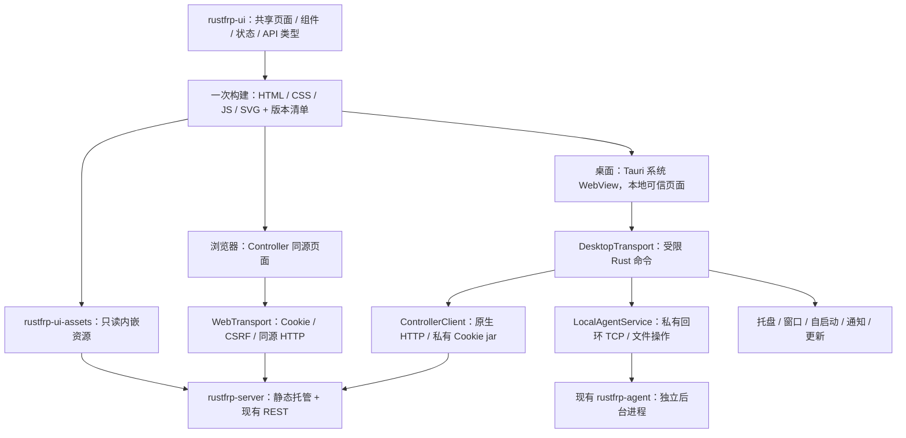

# RustFRP UI 框架重构方案与实施计划

日期：2026-10-14。状态：按用户批准实施；本机代码、测试、覆盖率与 Flutter 工程清理已完成，跨平台/签名/内存对照及窗口恢复性能仍按证据列为保留项，见 [实施与验收清单](UI_REFACTOR_STATUS.md)。用户确认：本期不设 24 小时长稳门槛。

研究基线：RustFRP `6058ade`；Magpie `f074996d93b87b17ea682c4b5951d52794bb28cb`，该提交时间为 2026-10-14 09:38:12 +08:00。本文核查了两边的源码和官方框架文档，没有运行 Magpie 性能基准。当前浏览器与 macOS WebView 已有短时性能样本；新桌面和旧 Flutter 的同场景进程树内存对照尚未完成。

## 1. 建议采用的架构

采用 **一套原生 HTML/CSS/JavaScript 界面 + Rust 桌面宿主 + Rust Controller 静态资源托管**。桌面宿主优先选择 Tauri 2，使用系统 WebView；同一份业务界面在浏览器和桌面内运行。

共享的是页面、组件、状态逻辑、资源和接口类型。浏览器通过同源 HTTP 调用 Controller；桌面通过受限 Rust 桥接调用 Controller，并提供本机 Agent 与系统能力。平台差异集中在适配层。

服务端“集成 UI”是将静态资源内嵌或随包托管，渲染发生在访问者的浏览器。Controller 不需要运行 WebView、JavaScript 服务端运行时或桌面窗口，因此纯服务端安装可以继续保持现有资源目标。

桌面初期只创建一个主 WebView，托盘使用原生菜单。默认不增加第二个托盘 WebView；窗口隐藏后暂停页面活动，并提供释放 WebView 的省内存策略。

## 2. Magpie 源码研究结论

### 2.1 已确认的实现

| 部分 | 源码事实 | RustFRP 的借鉴方式 |
|---|---|---|
| 桌面宿主 | `go.mod` 使用 Wails v3 `v3.0.0-beta.24`；`app.go` 将共享 Handler 接到 Wails 资源处理入口 | 系统 WebView 加很薄的桌面宿主，业务页面独立于窗口框架 |
| 双端复用 | `api.go` 的 `//go:embed assets` 嵌入静态页面；`web.go` 在浏览器模式使用同一 Handler | 一次构建的前端资源同时供 Controller 与桌面使用 |
| 前端渲染 | `index.html` 加载手写 JS/CSS；`app.js` 直接创建、更新 DOM，未使用 React/Vue 等组件框架 | 原生 DOM、CSS 变量、语义化表单与轻量组件模块 |
| 节点复用 | `replaceKeeping()` 保留既有 DOM 节点；源码注释记录了重建输入节点造成中文 IME 重复输入的实际问题 | 按资源 ID 复用行与表单；轮询不替换正在编辑的输入节点 |
| 刷新调度 | 刷新条件检查页面是否隐藏、当前视图及弹出菜单；部分刷新只在数据变化后重绘 | 页面级订阅、同一资源只保留一个请求、后台暂停与增量更新 |
| 发布缓存 | `revalidated()` / `versionedPage()` 给资源加内容哈希，匹配版本使用 immutable 缓存；Web 模式支持 gzip | 内容哈希文件名、入口重新验证、预压缩产物与明确版本清单 |
| 空闲资源 | `lightweight_rule.go` / `lightweight.go` 在轻量模式下将关闭 30–60 秒的窗口释放，重开时重建 | 原生托盘与 Agent 独立存活；释放页面后再打开恢复非敏感状态 |
| 平台适配 | 存在 WebKitGTK/Wayland 绘制问题的专门处理和 macOS WebView 释放代码 | 三个平台分别测量；动画与窗口回收不能只靠浏览器测试判断 |

这些机制为减少不必要的下载、DOM 重建和后台活动提供了依据；它们不能单独证明某个框架在 RustFRP 的场景中更快，最终判断需要对照测量。

### 2.2 应调整的地方

Magpie 当前 `app.js` 已有 **25,224 行**，源码约 **1.26 MiB**，gzip 约 **389.73 KiB**；`app.css` 约 **312.78 KiB**，gzip 约 **66.11 KiB**。它的“原生前端”也会随业务增长，不能仅凭没有框架就认为资源一定很小。

RustFRP 从第一天按业务模块拆分代码，保留公共组件和适配层；不复制一个巨大的全局脚本，也不引入 Magpie 的插件运行时、模型管理等无关功能。必要的构建工具用于类型检查、模块拆分、压缩与资源哈希，不成为部署运行时。

Magpie 的 Web 登录使用运行密钥与 Cookie；RustFRP 已有管理员、角色、CSRF 和审计体系，继续沿用本项目的身份模型。

## 3. RustFRP 当前基础与迁移范围

### 3.1 已具备的基础

- Controller 已提供 `/api/v1` REST，业务与 Flutter 组件不强耦合；`rustfrp-server/src/api.rs` 负责 Cookie、CSRF、同源检查与权限。
- Controller 已通过 `RUSTFRP_PANEL_DIR` 托管静态文件。当前静态处理函数每次用 `tokio::fs::read` 整文件读取，后续可改为有界流式传输或内嵌只读资源。
- Agent 的本机控制是私有回环 TCP + 换行 JSON，**不是 HTTP API**。浏览器不能直接调用，需要桌面 Rust 层接入；发现令牌由宿主读取，不传到 JS。
- 桌面能力已有完整参考实现：本机受管/独立模式、随包 Agent、后台启停、配置校验和原子保存、日志/诊断、托盘、自启动、通知与两类更新器。
- UI 外观已经确认，继续以 `docs/UI_SPEC.md` 和现有主题 token 为迁移依据。

本机控制协议文档部分描述仍落后于实现，例如页面接入状态与证书指纹支持。迁移盘点以源码、测试与 `docs/IMPLEMENTATION_STATUS.md` 交叉核对，并在协议阶段修正文档，不能据旧文档漏掉现有能力。

### 3.2 当前 Web 产物测量

本次读取现有 `rustfrp-app/build/web`，使用文件逻辑字节数及 Python gzip 压缩测量：

| 指标 | 字节数 | 换算 |
|---|---:|---:|
| 整个 Web 构建目录 | 50,240,781 | 47.91 MiB |
| `main.dart.js` 原始文件 | 3,002,104 | 2.86 MiB |
| `main.dart.js` gzip | 879,182 | 858.58 KiB |
| `canvaskit/` 目录 | 37,851,412 | 36.10 MiB |
| `fonts/` 目录 | 4,668,494 | 4.45 MiB |

整个构建目录包含多种引擎产物、符号文件和不同平台变体，**不等于一次首屏下载量**；gzip 数值是本地压缩结果，不代表当前服务已发送 gzip。真实首屏请求、浏览器内存与桌面总内存需要在 P0 补测。

### 3.3 迁移验收矩阵

| 功能组 | 必须迁移的能力与关键验证 |
|---|---|
| 登录与会话 | 同源 Web 登录、桌面 Controller 地址、会话恢复/失效、CSRF、角色边界、退出与切换服务器 |
| 概览 | 六张紧凑指标卡、24h/7d 流量、客户端/隧道筛选、未采样与断点语义、Controller 版本/运行信息 |
| 节点管理 | 内置/独立 Edge、状态/能力/地址、详情、重命名、启停/删除、审计理由与权限 |
| 客户端 | 标签/版本/IP、接入向导、详情、隧道与访问者、启停/下线/重启/升级、跨节点迁移 |
| 隧道管理 | 全部已有代理类型与选项、模板、CRUD、状态/错误、批量操作、加密压缩、限速/健康检查/插件 |
| 配置迁移 | 导入预览、兼容报告、警告确认、理由、应用、标准 frp 配置导出 |
| 审计与设置 | 日志游标/缺口、主题、管理员及最后 Owner 保护、接入令牌/API Token、凭据只显示一次、应用更新 |
| 桌面本机 | 受管/独立启动与恢复、完整 TOML/YAML/JSON 编辑、Agent verify、原子保存/回滚、日志/流量/诊断 |
| 系统集成 | 单实例、原生托盘、关闭到托盘、自启动、通知、随包 Agent 定位、Agent/App 更新与平台安装 |

新增页面应逐项关联既有测试场景。列表和详情变成 HTML 后，权限、写操作理由与配置兼容边界仍需通过真实 API 验证。

## 4. 技术选型

| 桌面宿主 | 匹配度 | 成本与判断 |
|---|---|---|
| **Tauri 2，推荐** | Rust 宿主 + 系统 WebView，能直接承接本项目 Rust 逻辑 | 有窗口、托盘、打包与权限机制；需要控制插件和命令范围，并实际验证三平台内存 |
| Wails v3 | 最接近 Magpie；同样可以加载共享原生页面 | 桌面增加 Go 工具链与运行时，需维护 Go 与 Rust 的控制边界；Magpie 当前使用 beta 版本，迁移成本需单独评估 |
| Wry/Tao 薄壳 | Rust + 系统 WebView，窗口层可按需裁剪 | 托盘、生命周期、更新、签名与安装等自行整合，维护成本较高；作为原型测量后确有必要时的替补 |

Tauri 使用 macOS WKWebView、Windows WebView2、Linux WebKitGTK。系统 WebView 减少随包引擎体积，但渲染、GPU/网络等辅助进程仍消耗内存。Agent/Edge 的 10 MiB 目标与桌面进程树预算要分别管理。[官方进程模型](https://v2.tauri.app/concept/process-model/)

### 4.1 前端运行与工程工具

- 运行时：语义化 HTML、CSS、标准 JavaScript ES Modules，使用浏览器原生 DOM。
- 源码建议使用 TypeScript 表达 API/宿主接口类型，构建后为普通 JS；TypeScript 不增加运行时。若坚持 JS 源码，可用 JSDoc 类型检查维持同样边界。
- 构建：优先使用固定版本的 esbuild 与类型检查工具，生成压缩、分块、内容哈希资源；锁文件入库。Node 只参与开发/CI。
- 状态：小型显式 store + 按字段订阅；页面具备 `mount/update/unmount` 生命周期。只实现本项目所需能力，不开发通用框架。
- 图表：流量图优先 SVG；绘制点数按显示宽度聚合，保留原始值、时间范围、缺口和未采样语义。
- 字体：优先系统中文字体与系统 UI 字体栈；需要一致字体时按需自托管 WOFF2，纳入下载预算；不依赖外部 CDN。
- 图标与品牌：复用已确认 Logo，用按需 SVG 图标替代整套图标字体；保留来源与许可信息。
- 测试：前端行为单测与 Playwright 浏览器测试，桌面 Rust 逻辑使用可注入接口与真实宿主专项测试。

## 5. 双端共用与进程边界



### 5.1 同一份 UI 的具体含义

页面只依赖 `ControllerTransport` 和 `HostCapabilities`，不导入窗口框架到每个业务组件。Web 与桌面业务资源使用相同内容哈希；Tauri 的桥接注入、入口 CSP 等宿主处理单独验证，不能要求所有封装后的 HTML 字节完全一致。

- 浏览器适配：相对 `/api/v1` URL，Cookie 由浏览器处理，CSRF 放入写请求头；请求超时、401/403、取消与错误体统一处理。
- 桌面适配：本地打包页面调用限定业务操作，Rust 使用原生 HTTP 请求 Controller。Cookie/CSRF 由 Rust 会话层持有，Cookie 与发现令牌不返回给 JS；返回业务 JSON、结构化错误和受限进度事件。
- 本机适配：只在桌面启用。发现文件、回环控制、进程监督、配置文件和诊断由 Rust 完成；浏览器明确显示可用能力。
- Controller 模式继续允许连接已有远端，桌面本机模式不需要为了显示 UI 启动一个完整 Controller。

现有桌面 HTTP 客户端本来就不依赖浏览器跨域。新桌面沿用这个边界，避免为了 WebView 的跨域 fetch 放开 Controller 的同源限制。

### 5.2 Controller 静态资源集成

提供默认内嵌资源与现有目录覆盖两种方式：

1. 构建 `rustfrp-ui` 后生成只读资源清单与 `rustfrp-ui-assets`，Rust 发布二进制可直接包含管理面板。
2. 内嵌资源通过静态字节切片响应，避免每次复制完整资源到堆；gzip/Brotli 在构建阶段预生成，按客户端支持选择，设置 `Vary: Accept-Encoding`。
3. `RUSTFRP_PANEL_DIR` 继续作为显式外部目录覆盖，便于 UI 单独发布和回滚。文件传输采用有界流式读取，校验相对路径与规范化后目录边界，阻止路径穿越和符号链接越界。
4. 入口 HTML 重新验证；哈希命名的资源使用 immutable 长缓存。缺失 JS/CSS 返回 404，不能伪装为 SPA 的 HTML；未知 API 路由继续返回 API 错误。
5. 资源清单包含 UI 版本、内容摘要与兼容 API 标识。页面遇到不兼容后端时显示明确错误；版本能力协商若需新增 API，先更新协议与 fixtures。
6. GUI 依赖只在桌面工程。构建 Controller/Agent 不要求 WebKitGTK、WebView2、Tauri 或 Go；纯服务端安装无需 Node 与浏览器引擎。

资源嵌入采用显式构建 feature，正式发布流水线固定先构建 UI 再编译带面板的 Controller。后端 API 测试和纯数据面构建支持不带内嵌 UI；构建脚本不联网下载资源，发布检查拒绝缺失或版本不匹配的资源清单。

内嵌只读资源仍可能产生映射页 RSS，不能称为零内存；预算和实测覆盖映射页、缓冲和并发静态请求。

### 5.3 桌面命令与权限

Tauri 默认对自定义注册命令的权限有单独规则，不能只安装 capability 文件便认为业务桥接已经受限。使用 `AppManifest::commands` / 显式权限，并在命令入口验证可信窗口与来源。[官方 capabilities 说明](https://v2.tauri.app/security/capabilities/)

- 仅本地打包页面获得本机控制、文件与进程命令；外部链接交给系统浏览器，拒绝主窗口任意远程导航。
- 若以后提供直接打开 Controller URL 的窗口，它只提供普通远程 Web 页面权限，不授予本机桥接；该能力不是首版必需。
- 命令以类型化业务操作为单位，不暴露任意 shell、任意文件读写或携带 Cookie 的任意 URL HTTP 代理。
- Controller 地址通过显式服务器配置选择；限制协议、重定向和凭据转发，HTTPS 验证沿用既有信任要求；回环开发 HTTP 单独定义。
- 修改类命令校验入参、范围与状态；远端业务权限和审计最终仍由 Controller 执行。
- Web CSP 与桌面 CSP 分开配置。新 Web 页面移除 Flutter 所需的 `wasm-unsafe-eval`；避免动态代码执行与内联事件处理。桌面仅开放必要 IPC/资源来源。

### 5.4 桌面后台与更新

- Agent 生命周期独立于页面：关闭/释放窗口、退出桌面均不自动停止 Agent；只有显式停止才发送停止命令。
- 原生托盘维护最小必要状态；后台监督 Agent 的退出码、升级和恢复，通知不依赖页面存活。
- 省内存模式在窗口隐藏约 45 秒后尝试释放 WebView；存在未保存表单、配置编辑或一次性凭据时暂缓释放。只保存非敏感导航和筛选状态，重开重取实时数据。
- 实际验证释放后的渲染/网络/GPU 辅助进程及共享进程，不能只检查宿主 RSS 或窗口可见性；若上游宿主不能释放，记录证据后调整实现。
- 现有 CA-07 Agent 更新和 D-09 App 更新的签名、摘要、取消、替换/回滚及平台安装逻辑迁到 Rust 适配层。Tauri 更新插件不视为现有自定义签名清单的直接替代，先验证格式、信任根与迁移策略。
- 桌面会话默认仅内存保存；持久化偏好包含地址和主题，不包含密码/接入令牌。跨旧版设置迁移采用白名单读取和原子写入。

## 6. 渲染性能与交互实现规则

1. **先反馈，再等待网络**：点击同步进入 loading 状态，锁住重复操作；成功与失败都有明确反馈。写请求超时显示结果未知并查询实际状态，不自动重发创建/导入等非幂等请求。
2. **更新变化字段**：按资源 ID 保留行、焦点、滚动、选中与输入。刷新不能覆盖编辑内容；写成功使相关缓存失效，并用请求序号防止旧读响应覆盖新状态。
3. **仅刷新当前需要的数据**：活动视图沿用约 5 秒实时读取；编辑弹窗暂停相关列表重绘；页面隐藏后停止 UI 轮询。Agent 的监督/通知由宿主独立维护。
4. **任务有界**：每个资源一个在途读取，切页取消旧请求与订阅；合并同一帧 DOM 写入，避免布局读写交替。页面缓存设条目/字节上限，登出清除业务数据与凭据展示。
5. **列表随规模适配**：常规数据使用分页/按需显示；大列表虚拟化，保持可见 DOM 行数量有界，并验证键盘、焦点和批量选择。当前 clients/tunnels API 返回完整数组，虚拟化只能降低 DOM 成本；大规模数据传输和服务端内存另需兼容分页协议，不能伪称已经解决。
6. **日志与图表有界**：沿用游标和 gap 提示；日志显示缓存初始上限 1024 条。7 天流量保留有界数据，绘制按像素聚合，缺口和累计口径不变。
7. **轻量动画**：交互优先 opacity/transform，尊重 reduced-motion；不使用持续装饰动画和大面积模糊。View Transitions 仅在目标引擎验证后启用，有稳定降级路径。
8. **原生交互完整**：语义化表格和表单、真实文本选择、Tab/Enter/Escape、对话框焦点返回、中文 IME、复制失败反馈与长文本全文查看。
9. **保留外观契约**：菜单名称、草绿主操作、深浅色、160/72px 侧栏、40px 行高、6px 菜单间距、12px 图文间距、六卡断点与宽窄屏详情沿用当前 UI 规范。

## 7. 性能预算与验证口径

以下为建议的工程目标，不是已达成数据。P0 记录旧版本与空白 WebView 的平台基线，P1 原型确认可达性；调整预算必须保留原因和前后测量。

| 对象 | 建议目标 | 测量边界 |
|---|---|---|
| 首屏业务资源 | JS gzip ≤120 KiB，CSS gzip ≤35 KiB；首屏 UI 资源合计 ≤200 KiB | 冷缓存，含首屏所需图标和自托管字体；明确排除 API 数据与系统已有 WebView |
| 全部业务代码 | JS/CSS gzip 合计 ≤500 KiB，非首屏功能分块加载 | 统计全部业务分块，不能只计入口脚本 |
| Web 冷启动 | 本机同源可交互外壳 ≤700ms；4 Mbps / RTT 80ms 场景 ≤1.5s | 记录设备、引擎、缓存、网络；登录/业务数据到达另计 |
| 桌面打开 | 可交互外壳冷启动 ≤1.5s，保留窗口重开 ≤200ms | 冷启动包含宿主与 WebView；释放窗口重开单独统计 |
| 点击与键入 | 本地反馈 p95 ≤50ms；正常滚动接近 60Hz | 交互耗时与网络返回分开；记录长任务及绘制帧，不仅测 JS 函数执行 |
| 桌面可见内存 | 目标较同平台 Flutter 基线降低 ≥30% | 同数据/字体/窗口/刷新策略，计入宿主与关联 WebView 辅助进程；绝对门槛 P0 按平台制定 |
| 桌面隐藏 | 页面任务停止；轻量模式释放 WebView 后接近该平台无窗口宿主基线 | 记录宿主、Agent 及关联进程；共享页使用 PSS/物理占用辅助解释 |
| Controller | 原有典型常驻 ≤12 MiB 目标；新增静态托管稳态增量目标 ≤1 MiB | 同一业务负载，区分静态访问、登录短时峰值与常驻；并发访问/冷读另测 |
| Agent/Edge | 原有典型 ≤10 MiB 目标继续成立 | UI 使用系统 WebView不改变数据面预算；退出/释放界面不影响隧道 |
| 长时间稳定性 | 本期按用户确认不设验收门槛，不执行 24h 测试 | 保留短时切页/窗口循环与缓存、订阅、队列的有界性检查；长期趋势另行安排 |

跨平台不直接比较 RSS 数字：Linux同时记录 RSS/PSS，macOS记录可归属进程与物理占用，Windows记录 working set/private bytes。浏览器共享 GPU/网络进程的归属需注明，不能把其他标签页一并算入或完全遗漏。

基准场景至少覆盖：登录外壳；50 客户端/500 隧道；大列表压力；24h/7d 图表；连续日志；弹窗输入时轮询；页面切换 100 次；窗口开关/释放 30 次；慢网/断网/会话失效。浏览器性能基线各场景冷启动至少 10 次、暖操作至少 30 次，报告分位数和异常。

## 8. 目录与构建建议

```text
rustfrp-ui/
  src/
    app/                 # 启动、导航、显式状态、生命周期
    components/          # 表格、对话框、表单、通知、图表
    features/            # 概览、节点、客户端、隧道、审计、设置、本机
    platform/            # Web / desktop 传输与宿主能力
    api/                 # 接口类型、错误、契约、请求操作
    styles/              # token、主题、布局与组件样式
  tests/                 # 行为、契约、浏览器与视觉用例
  dist/                  # 生成产物，Git 忽略
rustfrp-ui-assets/        # 构建资源清单、只读资源访问，无 GUI 依赖
rustfrp-desktop/
  crates/support/        # HTTP 会话、本机控制、配置/诊断/更新等可测逻辑
  src/                   # Tauri 薄宿主、受限命令与生命周期
  capabilities/          # 明确的命令/窗口权限
  tests/                 # 平台集成与宿主专项验收
tools/ui/                # 大小预算、性能采样、截图和清单核对
target/ui-refactor-baseline/ # Git 忽略的旧 Web/桌面构建参考产物，不是源码依赖
rustfrp-web/             # 现有官网，与管理面板工程分开
```

桌面初期使用独立 Cargo workspace 与独立 CI job，避免现有服务端 `cargo build --bins` / 覆盖率 Job 被迫编译 GUI。新增 Rust crates 的覆盖率与 lint 同样纳入统一入口，不能因 workspace 分离而漏检。

实施后入口为 `make ui-test ui-cov ui-build ui-shots`、`make desktop-test desktop-cov desktop-build`；`make cov`、`web-build`、`start_dev.sh`、CI 和 Release 工作流均已切换到共享 UI/Tauri。Flutter 命令和工程依赖已删除。本地 Web 预览继续固定端口 9674。

## 9. 分阶段实施计划

工作量为一名熟悉项目的工程师的有效人日估计，含本阶段验证，不是保证工期；签名凭据、目标主机准备及外部发布等待单独列出。

| 阶段 | 工作与可评审交付物 | 退出条件 | 估计 |
|---|---|---|---:|
| P0 基线与功能盘点 | 固定旧版产物；API/桌面行为矩阵；Flutter Web/桌面与空白系统 WebView 性能基线；补齐协议文档差异 | 有可重复测量脚本、原始结果与完整迁移清单，确定平台绝对预算 | 1–2 人日 |
| P1 双端架构原型 | 共享 DOM 登录/概览/一张资源表；Web 同源 + Tauri 原生 HTTP；本机 status；内嵌资源与 hash 清单；桥接权限 | 同一业务资源在两端运行；登录/写理由/401/403 完整；原型性能达标，Agent 不受窗口退出影响 | 3–4 人日 |
| P2 公共交互底座 | token 到 CSS；两栏布局；表格/弹窗/表单/提示；请求取消/去重/缓存；权限显示；暗色/窄屏/IME | 宽窄/深浅、键盘、输入中刷新和重复点击通过；资源预算可自动校验 | 3–4 人日 |
| P3 管理页面迁移 | 概览 → 节点 → 客户端/访问者 → 隧道/模板/批量 → 配置导入导出 → 审计/系统设置 | 每条迁移矩阵均有真实 API 成功/失败证据，配置兼容与权限不退化 | 7–10 人日 |
| P4 桌面能力迁移 | Rust 本机服务层、受管/独立模式、配置 verify/原子保存、诊断；托盘/自启动/通知；Agent/App 更新；偏好迁移 | 桌面行为矩阵通过；轻量释放/重建与独立 Agent 生存通过；签名拒绝/升级/回滚路径分别验证 | 5–7 人日 |
| P5 三平台整体验证与发布 | 浏览器三引擎、真实系统 WebView；短时性能、安装/卸载、更新/签名流水线；回退演练 | 质量门槛通过，逐平台记录可取得的实机证据；发布凭据按实际配置标记 | 4–6 人日 |
| P6 切换与清理 | 新默认面板/桌面；保留旧发布包与数据备份；删除 Flutter 工程、依赖和入口；同步文档 | 功能、资源与回退复核通过，遗留验收不被错误标为完成 | 2–3 人日 |

预计完整迁移 **25–36 人日，约 5–8 周**。最先交付的是 P0/P1 的双端原型和对照数据，约 4–6 人日。若缺目标平台主机或签名凭据，开发与可验证部分继续完成，平台发布验收单独记录等待条件。

P3 按完整业务路径迁移页面，每个路径都覆盖读取、编辑、提交、权限、审计、刷新和错误；代码批量实现后组织整体联调，避免只交付静态界面。P0/P1 的架构测量是前置门槛，防止完成全部页面后才发现宿主不满足资源要求。

## 10. 质量、发布与回退

### 10.1 测试与覆盖率

- 现有 Rust 每 crate 行/函数/分支 ≥90% 继续执行；新增桌面支持与资源服务代码也纳入基线。
- 新前端行/函数/分支均 ≥90%，以行为断言为主，覆盖角色、状态、异常、输入与提交。
- 系统 API 薄封装的不可执行部分按现有规则登记排除，并提供平台手工清单；业务逻辑通过可注入接口测试，不能把整个桌面 crate 排除。
- Playwright 覆盖 Chromium、Firefox、WebKit，验证真实 Controller 与写入审计；浏览器 WebKit 通过不代表 WKWebView/WebKitGTK 已验收。
- Windows/Linux 可使用桌面 WebDriver；macOS 依官方当前支持选择 WebdriverIO 适配或宿主自动化/实机操作，原生 WebDriver 不直接假设可用。[官方测试说明](https://v2.tauri.app/develop/tests/)
- UI 视觉验收包括真实字体、1440/1024/720/390px、深浅色、缩放、空/错误/加载状态；操作验证包括表格末列、移动端菜单、IME、焦点与一次性凭据。
- 后端改动运行现有 lint/test/cov/E2E/内存检查；桌面与前端执行各自完整门槛。只改方案文档时不重复执行运行时测试。

### 10.2 发布和版本兼容

共享 UI 发布同时生成静态包、内嵌清单与桌面资源输入，记录同一构建的内容摘要。先验证支持的 Controller API 版本范围；桌面/服务器更新速度不一致时显示明确能力边界。

新 UI 通过独立静态发布目录和内嵌构建验证。外部目录托管可通过目录/符号链接原子切换回退，已缓存的哈希资源在保留期内不删除。内嵌资源随二进制切换，但替换 Controller 会影响同进程内置 Edge，需要安排该模式的发布窗口；不能将静态目录切换的无重启特性套用到二进制升级。

桌面偏好迁移读取旧配置后写入新命名空间，并保留旧配置备份；不改 Agent 身份与 frp 配置格式。发布后回退旧桌面时，后台 Agent 仍可接入；Agent 本身的版本升级遵守原有独立签名与回滚流程。

切换时同步了 `README.md`、`AGENTS.md`、`docs/UI_SPEC.md`、技术设计、开发规范、`IMPLEMENTATION_STATUS.md`、`HANDOFF.md`、本机协议和 Release 文档。长时间稳定性不属于本期门槛。当前短时实测：浏览器本地反馈 p95 26ms；macOS release WebView 30 次窗口恢复首帧 p95 516ms，高于建议的 200ms；Ubuntu 24.04 ARM64 WebKitGTK/Xvfb release E2E 的对应 p95 为 52ms。桌面进程树内存对照尚无数据。本文方案不替代 Windows/物理 Linux 实机、真实签名 Release 或正式安全审计。

### 10.3 最主要的风险与处置

| 风险 | 实施处置 |
|---|---|
| 换宿主后总内存未下降 | P0/P1 同场景进程树测量；先裁剪窗口/后台任务/插件，再评估替补宿主 |
| 手写前端变成大型全局脚本 | 按业务模块与生命周期拆分，组件复用，类型检查与大小预算，避免重建通用框架 |
| 新外观遗漏成熟能力 | 迁移矩阵绑定既有测试和真实 API；P3/P4 各完成整条业务路径 |
| 桌面远端访问或本机桥接权限扩大 | 本地可信页面 + 类型化操作；原生会话层；来源/窗口/文件/命令范围检查 |
| WebView 平台差异 | 实机测试字体、IME、图形加速、托盘与释放；功能检测与降级，平台修复留在宿主层 |
| 更新器更换破坏签名链 | 对现有签名格式与可信公钥单独迁移，篡改/缺密钥/取消/中断/回滚均验收 |
| 原型通过但长期资源上涨 | 有界缓存/日志/订阅与短时窗口循环检查；本期不执行 24h 趋势采样 |

## 11. 研究来源

Magpie 源码固定到上述提交，避免后续 main 变化影响本次结论：

- [Magpie GUI 架构文档](https://github.com/yetone/magpie/blob/f074996d93b87b17ea682c4b5951d52794bb28cb/docs/subsystems/gui-shell.md)
- [Wails 版本与依赖](https://github.com/yetone/magpie/blob/f074996d93b87b17ea682c4b5951d52794bb28cb/go.mod)
- [桌面入口与资源 Handler](https://github.com/yetone/magpie/blob/f074996d93b87b17ea682c4b5951d52794bb28cb/internal/gui/app.go)
- [嵌入资源、缓存与内容版本](https://github.com/yetone/magpie/blob/f074996d93b87b17ea682c4b5951d52794bb28cb/internal/gui/api.go)
- [Web 托管与身份边界](https://github.com/yetone/magpie/blob/f074996d93b87b17ea682c4b5951d52794bb28cb/internal/gui/web.go)
- [DOM 更新、输入保护与刷新调度](https://github.com/yetone/magpie/blob/f074996d93b87b17ea682c4b5951d52794bb28cb/internal/gui/assets/app.js)
- [CSS 与系统字体](https://github.com/yetone/magpie/blob/f074996d93b87b17ea682c4b5951d52794bb28cb/internal/gui/assets/app.css)
- [轻量模式规则](https://github.com/yetone/magpie/blob/f074996d93b87b17ea682c4b5951d52794bb28cb/internal/gui/lightweight_rule.go)、[窗口释放](https://github.com/yetone/magpie/blob/f074996d93b87b17ea682c4b5951d52794bb28cb/internal/gui/lightweight.go)、[macOS WebView 处理](https://github.com/yetone/magpie/blob/f074996d93b87b17ea682c4b5951d52794bb28cb/internal/gui/lightweight_darwin.go)
- [Linux WebKitGTK 绘制适配](https://github.com/yetone/magpie/blob/f074996d93b87b17ea682c4b5951d52794bb28cb/internal/gui/webkit_linux.go)
- [Tauri 架构](https://v2.tauri.app/concept/architecture/)、[进程模型](https://v2.tauri.app/concept/process-model/)、[权限](https://v2.tauri.app/security/capabilities/)、[CSP](https://v2.tauri.app/security/csp/)、[测试](https://v2.tauri.app/develop/tests/)、[更新](https://v2.tauri.app/plugin/updater/)

RustFRP 核查入口：`rustfrp-server/src/api.rs`、`rustfrp-agent/src/local_control.rs`、`rustfrp-ui/src/api/`、`rustfrp-ui/src/features/`、`rustfrp-desktop/crates/support/src/`、`rustfrp-desktop/src/`、`rustfrp-ui/tests/`、`rustfrp-ui/e2e/`、`docs/UI_SPEC.md`、`docs/IMPLEMENTATION_STATUS.md` 与 `.github/workflows/release.yml`。旧 Flutter 源码不再保存在仓库。
